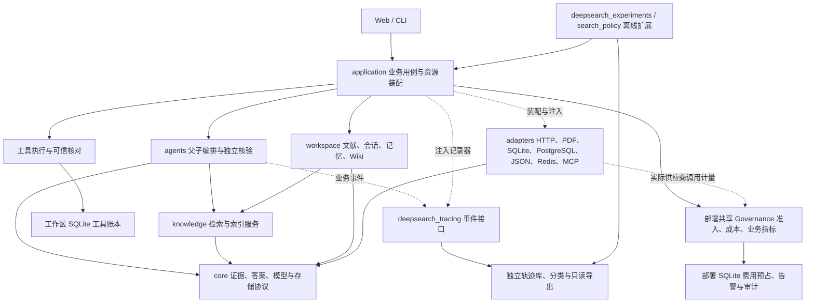
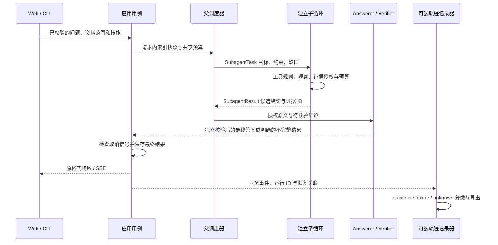

# 当前架构与依赖边界

适用版本：2026-10-20，包含恢复一致性与部署治理增量。模块边界以本文和 [ADR-0010](adr/0010-isolated-agents-modular-boundaries.md) 为准，配额和资源保护由 [ADR-0014](adr/0014-deployment-governance.md) 补充；旧实验的代码身份与分数见 [历史版本索引](HISTORICAL_VERSIONS.md)。面试导读见 [技术报告](INTERVIEW_TECHNICAL_REPORT_20261019.md) 与 [后端知识点](BACKEND_ENGINEERING_KNOWLEDGE_20261020.md)。

同日增加的可选团队身份边界见 [ADR-0011](adr/0011-team-workspace-access.md) 与 [操作说明](TEAM_ACCESS.md)：`application.bootstrap_team` 负责多工作空间资源装配，`application.access` 负责身份与成员策略，`adapters.persistence.access` 独立保存身份数据，`web.access` 在访问业务路由前执行授权与空间分派。每个空间复用下述原业务架构和数据格式，不复制问答实现。

可选 PostgreSQL 业务存储见 [ADR-0012](adr/0012-postgresql-business-store.md)：装配层通过 `adapters.persistence.business` 选择身份、会话/记忆与运行仓储；所有空间共享一个受控连接池，并以事务局部空间、复合约束和强制 RLS 隔离业务行。`MemoryManager` 只调用存储公开操作，不执行 SQL。文件/索引/检查点/轨迹保持独立；启动不自动升级表或迁移旧数据。操作与故障边界见 [数据库说明](DATABASE.md)。

## 业务主线

任务可靠性与恢复边界由 [ADR-0013](adr/0013-task-recovery-quality-loop.md) 补充：同步/流式会话共用持久任务和每空间最多 4 个活动任务的容量；同步请求及后台任务共同参与关闭取消和完成等待。`application.run_reliability` 只处理身份和安全诊断；存储适配器执行条件状态转换，已提交轮次用于修复状态歧义。API 根生命周期与离线维护共用部署文件锁；`maintenance_cli` 调用恢复适配器，备份和还原不经过业务 Web 路由。`deepsearch_tracing.quality` 独立冻结、审核与比较轨迹，生产问答不导入该评测流程。操作见 [运行保障说明](RELIABILITY_RECOVERY_QUALITY.md)。

真实问答统一由父 Agent 分派自包含目标与必要约束，子 Agent 在独立消息历史中执行工具循环，返回有预算的结构化结果。父调度器读取候选结论、证据 ID、缺口和停止原因；Answerer 与独立 Verifier 读取授权原文。只有核验后的最终答案可以保存并通过 SSE 发布。演示模式保留无网络执行。

图表示业务调用、接口实现和事件流；精确 Python 导入边界由 `python -m deepsearch_experiments.architecture` 检查。

## 目录与所有权

| 模块 | 所有权与主要入口 |
|---|---|
| `deepsearch_agent.core` | 标准库共享契约：证据与答案、模型响应与安全诊断、取消、身份、工具执行及治理上下文、实际跨边界协议、资源根路径 |
| `deepsearch_agent.application` | 问答、会话与线程、取消恢复、索引用例、Wiki；`tool_execution` 与 `tool_reconciliation` 处理执行及核对；`governance` 处理部署准入、成本与告警策略；装配层统一创建和关闭资源 |
| `deepsearch_agent.agents` | `runtime` 承载 LangGraph 主图；`agentic_research` 承载子图；角色处理分为 coordinator/researcher/answering，模型调用与上下文组装分离；任务契约、预算守卫与工具业务服务独立 |
| `deepsearch_agent.knowledge` | 分块算法、BM25、ANN、图像检索、重排、查询扩展、召回与上下文组装；`IndexService` 独占知识库、锁、写保护、脏标记和快照发布 |
| `deepsearch_agent.workspace` | 文献原件、附件、会话、用户/工作记忆、Wiki 页面与技能；`ingestion` 保存入库阶段与可复用产物；文献库通过索引服务发布快照，不持有 FastAPI 状态对象 |
| `deepsearch_agent.adapters` | 模型网关、PDF 子进程、视觉/Embedding、Redis、MCP、数据库与 checkpoint；`governed_calls` 在实际供应商调用边界计量，持久适配器保存费用和工具状态；框架工具包装仍由适配器负责 |
| `deepsearch_agent.web` | HTTP 校验与错误转换、响应模型、SSE 编码、中间件和路由；`RuntimeState` 为原 HTTP 消费方提供索引状态视图，数据仍由 `IndexService` 持有 |
| `deepsearch_tracing` | 仅标准库；事件作用域、SQLite 哈希链、可选记录生命周期、分类、父子交接查询与独立分组导出；不导入应用模型错误或 SDK |
| `deepsearch_experiments` | 评测、消融、多跳对照、旧快速 QA/查询规划、审计及依赖检查；不由生产启动加载 |
| `search_policy` | 标准库离线训练扩展：决策协议、审核、分组切分、SFT 导出与 reader；通过公共轨迹包读取审计流 |

前端 `app/App.tsx` 只协调视图、文献选择范围和证据弹层；`features/library/useLibrary.ts` 管理文献请求、轮询与快照操作，`LibrarySidebar.tsx` 负责文献库呈现。会话、证据预览、Wiki 分别位于 `features/chat`、`features/evidence`、`features/wiki`，请求类型与客户端位于 `shared/api.ts`。

## 强制依赖规则

1. `core` 和 `deepsearch_tracing` 只使用标准库及自身契约；分块元数据校验不再反向导入分块算法。
2. 生产业务禁止导入 `search_policy`、评测运行器，以及轨迹 SQLite/导出/分类实现。显式调用的历史 CLI 薄入口是唯一离线桥接例外。
3. 问答服务接收 `RunRecorder` / `EventSink`；应用轨迹适配器将统一网关异常转换为安全诊断。记录器不识别供应商异常或复制原始错误消息。
4. 工具业务服务不构造 LangGraph 工具。运行实现/装配层注入 `langgraph_tools`；框架只出现在主图、子图及工具适配器中。
5. 应用用例不导入 FastAPI/Starlette 或 Web DTO；`bootstrap` 与 `mcp_cli` 是明确的装配边界。HTTP 路由只校验、转换并调用应用用例。
6. `IndexService.publish` 先持久化、再切换活动快照；保存失败不替换原知识库。启动、手动恢复和文献后台入库共用同一所有者。
7. 只有实际跨模型、证据、记录和存储边界使用协议；不为每个内部类增加接口。
8. 一个部署只创建一个 `Governance`，所有工作空间共享资源池与费用仓储。HTTP 认证身份通过 `core.governance` 上下文传入业务；线程入口显式复制上下文，持久研究恢复保留原发起人归属。
9. 业务指标不携带用户、空间、运行 ID 或原文标签；指标故障不阻断回答。费用持久化故障在调用前阻止付费调用，调用后结算失败保留未知，不按零费用放行。

检查器包含函数内延迟导入，避免用“改为局部 import”隐藏循环。CI 回归还在独立进程中验证生产启动不加载离线包，关闭记录时不加载轨迹数据库实现。

## 问答与轨迹生命周期

- 主图检查点保存业务状态、可信证据及结构化交接；子图禁止继承父图检查点与消息历史。
- 逐会话锁保证轮次顺序；模型调用不长期持有索引锁。`RunWorkers` 拥有工作线程，退出时先取消并等待线程，再关闭 PDF 执行器、检查点连接和模型/Redis 资源。启动中途失败也按注册顺序释放已创建资源。
- 主流程运行 ID、每次记录 ID、子任务 ID、模型调用 ID 分别保留；恢复会产生新的记录并关联同一业务运行，不合并或覆盖历史尝试。
- 原始事件留在一条完整哈希链中。运行分类持久化为终态事件，导出到 `success/`、`failure/`、`unknown/`。内部核验、子任务完成、人工正确性、根因标签分别保存。
- 未结束、记录损坏/失败、缺失核验或最终答案的数据保持未知；人工标签默认 `null`。记录失败不改变问答结果，也不自动补为成功。
- Redis 只是可丢弃缓存和限流计数器；配置身份隔离、故障绕过/本地回退与资源关闭保持原行为。SQLite、原文和 JSON 索引仍是持久数据来源。

## 工具恢复与文献发布

工具账本以原运行和稳定调用位置生成 operation_id，另校验工具种类与参数摘要。已提交结果直接重放；可信前置条件失败保存为 `not_executed`。已进入付费或写操作调用边界但结果未确认时保持 `unknown`，恢复不会自动再次调用。核对需要可信供应商回执或受限的本地状态回读，并审计操作者、证明引用及结果摘要。费用已结算不等于工具结果已确认，两份账本各自决定恢复行为。

工作记忆的写授权同时绑定内容 revision 与持久 scope 标记。清空操作轮换 scope，旧检查点即使读取相同内容也不能恢复已撤销的授权。实际写入在锁内再次校验内容摘要。

文献入库按 parse、analysis、text_vectors、image_vectors、publication 保存意图与产物。产物绑定源文件、模型及处理配置，校验后可跨重启复用；已提交产物缺失或损坏不会自动重做付费步骤。索引已发布但 ready 元数据未提交时，通过来源内容和向量指纹确认后修复元数据。这是可恢复的阶段提交与后置条件核对，不是索引文件和业务数据库之间的分布式事务。操作见 [恢复一致性](BACKEND_RECOVERY_CONSISTENCY.md)。

## 费用、容量与业务观测

部署级 `governance.sqlite3` 保存费用预占、限额、核对审计与告警状态，纳入已有停写备份。用户和空间日额度在同一个 `BEGIN IMMEDIATE` 事务中检查；任意一维不足都不创建预占。费用依次进入 reserved、running、settled/unknown/released。启动时未进入调用的预占释放，已进入调用但未确认的费用继续冻结；跨 UTC 日界不自动清除未知费用。成本点是内部换算单位，缺失用量保持 null，超出估算记录实际值并告警。

研究、入库和模型/向量请求分别持有全局、用户及空间资源租约，超限明确拒绝；入库排队任务也占租约。缓存命中、工具结果重放不新增供应商费用预占。默认日额度不限额，全局研究/入库/供应商容量为 8/4/8，每用户和每空间为 4；这些是可配置保护值，不代表服务能力实测上限。

HTTP 请求、持久研究结果、供应商调用和工具结果分别计量。SSE 返回 HTTP 200 后仍可能产生业务 error。低基数进程指标与滚动 p95 用于当前状态；后台告警保存 pending/firing/resolved，通过受保护 API 与结构化日志输出。尚未配置外部通知栈。接口、状态机及边界见 [治理说明](GOVERNANCE_CAPACITY.md)；合成容量与进程故障验证见 [验证记录](GOVERNANCE_VALIDATION_20261020.md)。

## 配置与数据兼容

高并发、高可用与性能扩展的取舍见 [专题说明](CONCURRENCY_AVAILABILITY_PERFORMANCE_REDIS.md)。文本缓存已实现单次输入去重、同一缓存客户端实例及其快照共享的跨请求 singleflight，以及不延长 freshness 上限的向下 TTL 抖动。合并表按全批原子登记并限制键数，owner 先二次查缓存、批量计算自己拥有的键，再等待重叠键，避免交叉批次互等；只在实际计算结束后释放所有权。follower 有界等待，不取消、接管或自动重发 leader 的付费调用。实际回源保持 leader 的用户/空间上下文，缓存命中或 follower 复用不新建供应商费用预占。实现、配置和异常语义见 [缓存保护](REDIS_CACHE_PROTECTION.md)，本轮证据见 [验证记录](REDIS_CACHE_PROTECTION_VALIDATION_20261020.md)。

缓存键仍使用模型身份、凭据 scope 和文本摘要，格式不变；团队模式的不同缓存客户端实例不共享 singleflight 表，这不是跨工作区部署级合并或分布式锁。Redis 故障冷却和本地回退仍不提供 Sentinel/Cluster；L1、MGET/pipeline、负缓存、Bloom Filter 与跨进程协调尚未接入。多 API 部署需要共同调整任务认领、共享费用事实、索引版本与存储，不能通过增加 workers 绕开单进程所有权。

`core.paths.PROJECT_ROOT` 集中定位项目根目录，默认指向仓库根；可显式设置 `DEEPSEARCH_ROOT`。模块移动不参与数据目录推算。现有 `create_app(index_path=..., conversation_path=..., trace_path=...)` 注入路径和模型/资料身份仍有效；没有迁移或改写 `.env`、文献、检查点和人工审核文件。

真实模型默认启用父子 Agent。显式 `AGENTIC_RAG_ENABLED=false` 启动失败并提供离线入口提示，避免静默退回旧生产流程。`create_app(search_intent=...)` 同样给出离线迁移提示。旧算法通过 `deepsearch_experiments.legacy.qa.AnswerService` 显式使用；演示仍由配置选择 `DemoAnswerService`。演示和离线快速 QA 共用检索回答实现，不维护两套检索业务。

共享数据类型改变 Python 位置，SQLite 表、JSON schema、证据 ID、事件字段和 SHA256 计算保持原格式。唯一历史类路径别名为 `deepsearch_agent.chunking.TextChunk`；检查点适配器明确允许旧/新两个证据类路径，支持严格反序列化配置。旧文件直接读取，不批量重写。

评测代码身份仍使用 SHA256，但计算范围覆盖移动后的应用、轨迹与离线包；本次源码重构自然产生新的代码身份。已有实验可只读重新评分，不能用新代码冒充同一实现继续带身份校验的旧实验；新运行使用新目录。

重构删除明细和当时命令见 [迁移清单](ARCHITECTURE_MIGRATION.md)、[2026-10-18 验证](ARCHITECTURE_VALIDATION_20261018.md) 与 [容器及真实 Redis 验收](CONTAINER_REDIS_E2E_20261018.md)。2026-10-20 缓存保护增量后的导入审计为 214 模块、545 依赖、0 循环、0 违规，见[本轮验证](REDIS_CACHE_PROTECTION_VALIDATION_20261020.md)；发布与证据身份见 [发布记录](GITHUB_PUBLICATION_20261020.md)。继续保持单 API 进程，资源池与内存索引尚未扩展到多进程一致性。
