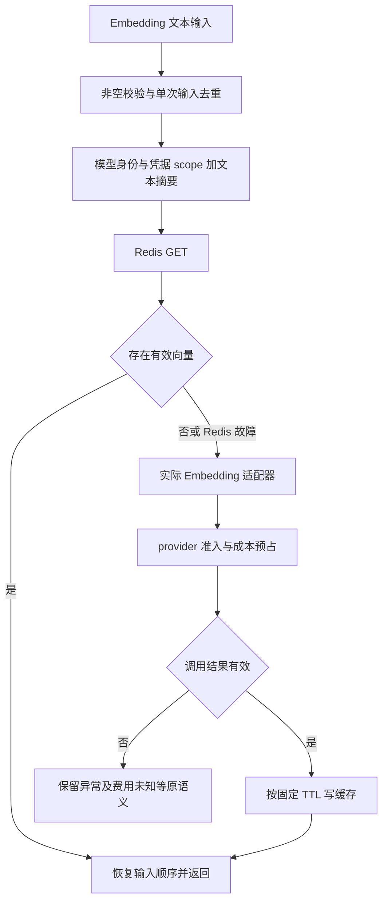

# 高并发、高可用、高性能与 Redis 缓存治理

本文把后端面试中的常见问题落到 DeepSearch 的请求、索引与付费调用链路。当前基线为 `fb440ef`，生产形态仍是单 API 进程；下文分别标记当前行为和扩展方案。本次只补充设计与教学文档，不改变缓存算法、部署方式或历史评测材料。

项目全貌见[技术报告](INTERVIEW_TECHNICAL_REPORT_20261019.md)，按源码学习见[后端知识点](BACKEND_ENGINEERING_KNOWLEDGE_20261020.md)，运行配置见[基础设施说明](INFRASTRUCTURE.md)与[成本及容量治理](GOVERNANCE_CAPACITY.md)。

## 1. 三类目标分别衡量什么

| 目标 | 业务问题 | 需要观察的指标 | 当前项目的落点 |
|---|---|---|---|
| 高并发 | 同时到来的研究、上传和查询会不会把依赖压垮 | 到达率、在途量、接纳/拒绝率、等待时间、资源峰值 | 全局/用户/空间准入、入库排队占额、逐会话锁、Redis I/O 数量上限 |
| 高可用 | 进程、机器或依赖故障时能保留哪些服务与数据 | 成功请求比例、故障检测/恢复时间、RTO、RPO、未知费用积压 | Redis 可降级、任务恢复、账本、备份还原；服务多副本和自动切换待建设 |
| 高性能 | 单个有用结果耗费多少时间、CPU、内存和费用 | 成功吞吐、端到端与分阶段 p95/p99、RSS、Token/调用成本 | 混合检索、批量 Embedding、缓存、快照与预算；每项收益需要分别测量 |

多接纳请求可能增加排队和尾延迟；快速拒绝可以保护系统，却会减少完成数；增加缓存能够降低模型调用量，却引入过期、隔离与热点重建问题。设计时需要同时报告这些变化。

一次评估至少分开四个数量：收到多少、接纳多少、最终完成多少、拒绝多少。成功吞吐是单位时间内完成的业务请求，不能把 503 也计入成功吞吐。SSE 的 HTTP 200 可能只表示流已经建立，研究失败应由业务终态判断。

已有[合成容量报告](GOVERNANCE_VALIDATION_20261020.md)为 144 条测量请求、68 条完成、76 条保护拒绝、0 条意外状态码。它验证收紧容量时的应用行为，不提供生产 QPS 上限或可用性承诺。

## 2. 当前实现与能力清单

| 机制 | 已实现的行为 | 尚未覆盖的内容 |
|---|---|---|
| 三维资源租约 | 单 API 进程内所有空间共享研究/入库/供应商资源池；任一维度超限拒绝 | 多进程统一准入、用户公平调度、供应商等待队列 |
| 持久成本预占 | SQLite 事务同时检查 user/workspace；未知用量继续占额 | 多 API 部署的分布式账务、真实货币定价 |
| Embedding 缓存 | 模型身份、凭据作用域和文本摘要组成键；命中校验；单次输入去重 | 跨请求 singleflight、TTL 抖动、L1、负缓存、批量 Redis 读取 |
| Redis 故障保护 | 短超时、失败冷却、每个 backend 最多 16 个在途 I/O；缓存绕过、限流本地回退 | 部署级 Redis I/O 总池、单探针 half-open、Sentinel/Cluster 客户端与部署 |
| 业务恢复 | 原运行、检查点、工具未知状态与费用状态独立核对 | 多机器任务接管、共享索引版本、自动故障转移 |
| 数据发布 | 索引服务持锁保存候选后切换；分阶段产物与发布核对 | 分布式索引发布、跨存储原子事务 |

这些状态来自当前源码核对，不意味着未列能力已经存在。源码入口：[缓存与限流](../src/deepsearch_agent/adapters/infrastructure.py)、[准入与指标](../src/deepsearch_agent/application/governance.py)、[调用与入库线程池](../src/deepsearch_agent/adapters/governed_calls.py)、[装配](../src/deepsearch_agent/application/bootstrap.py)、[部署模板](../compose.yaml)。

## 3. 高并发：控制在途工作与等待

### 3.1 一次请求经过多层保护

1. HTTP 边界检查身份、输入和请求频率。Redis 固定窗口计数以 Lua 原子执行 INCR 与首次 EXPIRE；来源使用连接对端，不直接信任任意转发头。
2. 问答准备资料范围与请求快照。会话线程保持认证上下文，逐会话锁维持轮次顺序。
3. 研究资源租约检查全局、用户和空间三个维度；当前超限明确返回容量错误，按入口体现为 HTTP 503 或 SSE 业务错误。
4. 真正模型/向量调用另取得 provider 租约，再做费用预占和调用标记。研究已接纳不保证后续 provider 一定有余量。
5. 完成、异常、取消及入库 Future 取消都按各自生命周期释放租约。已发请求的费用是否确认由费用账本决定。

默认全局研究/入库/provider 为 8/4/8，每用户和每空间为 4。入库提交时即占租约，排队也占额度；provider 当前不建立额外等待队列。外部 MCP 并未全部纳入该 provider 池。

速率限制约束一段时间内的进入次数，并发限制约束当前在途数量，费用配额约束累积使用。一次研究可能调用多次模型，它们需要分别设计，不能用一个 IP 限流替代用户成本额度。

### 3.2 用 Little's Law 估计在途量

在稳定系统与同一统计边界内：

$$
L=\lambda W
$$

`L` 是平均在途数，`λ` 是实际通过这条链路的平均速率，`W` 是平均停留时间。例如教学假设每秒接纳 8 条研究、每条平均 5 秒，需要约 40 条研究同时在途；它不是当前系统实测值。供应商调用速率还取决于每条研究的调用次数、入库请求以及缓存未命中量。

不能把平均耗时替换为 p95 后声称得到精确容量，也不能从“并发限制为 8”直接推导“吞吐为 8 QPS”。当服务时间增长而到达率不降时，无界等待会把内存、连接和用户等待一起推高。

当前选择快速拒绝；若未来增加等待，应同时限制队长、单用户占用、等待截止时间和取消传播。一次请求经过多个层次时还应共享总截止时间，不能每层都重新等满一个超时。

### 3.3 不要把请求结束当成工作结束

HTTP 断开、`Future.result(timeout=...)` 超时，都不必然终止底层线程或供应商执行。如果先释放工作资源、后台操作仍在运行，新请求可能继续进入并突破真实并发上限。

`RedisBackend` 在调用方等到超时后允许降级，但在途信号量由实际后台线程的 `finally` 释放。慢 DNS 占住的线程仍计入最多 16 个 I/O，避免无限创建线程。这个数量上限与模型 provider 租约是两套资源，不能相互替代。

16 是每个 RedisBackend 实例的上限。团队模式按空间装配独立运行环境，打开多个空间时连接池和 Redis I/O 上限可能叠加；当前部署共享的 Governance 并未给所有 RedisBackend 再加一个统一 I/O 租约。评估容量时需要统计实例数与连接总数。

### 3.4 当前快照准入的性能缺口

[一次性问答](../src/deepsearch_agent/application/library_service.py)在 `state.lock` 内解析资料范围并调用 `snapshot_answer_service`，随后才取得 research 租约。因此容量拒绝不能阻止此前的快照 CPU/内存开销。

[服务快照](../src/deepsearch_agent/application/service_base.py)使用浅拷贝服务并调用 `restrict_sources`；[资料范围快照](../src/deepsearch_agent/knowledge/knowledge_base.py)构建片段/向量列表、共享向量行，并清空 BM25/ANN 缓存。这与[入库候选](../src/deepsearch_agent/workspace/documents.py)的 `deepcopy` 不同，应分别测量分配量和索引重建成本。

可选改进是在廉价身份校验后提前准入，再取得固定版本快照，并在失败时释放租约；进一步采用不可变索引版本和共享只读缓存。需要验证权限范围、删除可见性与旧运行身份，不能直接删锁或共享可变列表。

## 4. 高性能：先定位关键路径，再减少工作

### 4.1 分解时间和成本

一次研究可以分为资料快照、检索/重排、模型等待、工具执行、核验、持久化及 SSE 发送。串行阶段可以相加；存在并行时需要看关键路径，不能把所有 span 耗时相加当作端到端耗时。

先记录每阶段的样本数、耗时分布和失败比例，再决定优化方向。当前已有部分研究/入库阶段、provider、HTTP 指标，但没有完整的快照锁等待、singleflight 等待、TTFT 和每种缓存重建指标，不能从已有出口宣称全部可见。

SSE 首个进度事件时间不等于模型首 Token 时间。前者反映用户多久看到反馈，后者反映模型生成时延，需要定义事件再采集。

### 4.2 缓存有命中，也可能有串行往返成本

当前一次 `embed(texts)` 对去重后的每个文本逐个 GET，并对未命中的每个向量逐个 SET。若 `N` 个不同文本全部未命中，会产生约 `N` 次 GET、`N` 次 SET，再加 Embedding 请求；网络往返、JSON 校验和线程调度都可能成为成本。

可选方案是分批 MGET 和 pipeline SET，按键映射恢复原顺序并保留校验。pipeline 减少逐条等待的网络往返，不自动提供事务隔离；MGET 的工作量仍随键数增长，需限制批大小。Cluster 下还要考虑键所在 slot 和客户端跨节点行为。[Redis pipelining](https://redis.io/docs/latest/develop/using-commands/pipelining/)、[MGET](https://redis.io/docs/latest/commands/mget/)。

不能为了 MGET 把全部工作空间缓存都放进同一个 hash slot，换来单分片热点；批次大小也不能无限增加，避免响应缓冲和尾延迟增长。

### 4.3 p95 不能按命中率线性求和

对于可比较的单请求样本，平均时延可用命中/未命中条件均值解释：

$$
E[T]=hE[T\mid hit]+(1-h)E[T\mid miss]
$$

p95 是混合分布的分位数，不能写成 `h × p95_hit + (1-h) × p95_miss`。当快慢两类样本明显分离、未命中超过 5% 时，总体 p95 仍可能落在慢路径。

向量缓存命中率也不等于研究请求全链路命中率；一条研究会检索、重排和核验多次。应同时统计“每个向量输入的命中率”和“每个完成研究实际调用次数/Token”，避免只优化局部指标。

### 4.4 从当前代码出发的优化顺序

| 观察结果 | 优先实验 | 必须保留的约束 |
|---|---|---|
| 相同文本并发回源 | 请求合并 singleflight | 模型/凭据/租户边界、有限等待、未知付费策略 |
| Redis 往返占比高 | 分批读取与 pipeline | 原顺序、向量校验、连接上限、部分失败行为 |
| 大文献集快照或索引重建占比高 | 共享不可变版本、按版本缓存检索结构 | 资料授权、原子发布、运行身份与恢复兼容 |
| 供应商等待占主导 | 调整批次和调用路径、复用已确认结果 | 供应商额度、输出质量、费用与取消语义 |
| 入库挤占研究 | 拆分池或保留优先级容量 | 全局上限、避免长期饥饿、独立工作进程后的索引可见性 |

线程适合把阻塞 I/O 从请求处理线程中分离；CPU 密集工作需要看解释器、算法与运行时。把同步阻塞代码改成 `async def` 不会自动降低 CPU 或网络时间。将任务移到进程后，还要传递身份、取消、持久认领和索引版本，不能只替换线程池类名。

## 5. 当前 Redis 缓存到底缓存什么

图为当前流程，没有跨请求 singleflight 节点。治理只在相应部署上下文中生效；演示、独立离线调用按各自入口执行。

当前键中的 `scope` 由装配层传入 API key 的 SHA256，不是 workspace_id。相同凭据、模型与文本可能跨空间复用向量；资料检索范围和引用权限仍由业务层检查。哈希不是加密，也不是访问授权，Redis 中的向量与访问模式仍需受控。

命中值必须通过维度、数值有限性和归一化校验，损坏值按未命中处理；供应商异常不会作为正常向量缓存。默认 TTL 为 86400 秒、没有随机抖动；`dict.fromkeys` 只合并这一次传入列表的重复文本，不合并另一个线程的调用。

## 6. 缓存穿透、击穿和雪崩

三者是常见工程分类，实际故障可以叠加。排查时先问“是查无对象、同一热点未命中，还是大量缓存同时失效”。

| 类别 | 触发方式 | 在本项目的例子 | 优先措施 |
|---|---|---|---|
| 穿透 | 持续查询本来不存在或不可服务的对象，每次都落后端 | 随机文献 ID 查询；高基数无效输入反复进入昂贵路径 | 输入与权限校验、有限负缓存、限流；有限对象集合可考虑存在性过滤 |
| 击穿 | 一个热点 key 未命中，多个请求同时重建 | 同一篇热门论文文本向量到期，多个研究同时请求 Embedding | singleflight、受控预热、必要时有界的旧值读取 |
| 雪崩 | 大量键接近同时失效，或缓存整体不可用 | 一次批量导入后固定 TTL 集中过期；Redis 重启或写满 | TTL 抖动、分批预热、回源容量保护、依赖降级与恢复节流 |

合法的新 Embedding 文本需要计算，本身不是“数据库不存在的对象”。如果请求输入不断变化，singleflight 和命中率优化帮助有限，需要输入/费用/速率保护。

### 6.1 穿透：负缓存与 Bloom filter 的适用前提

负缓存可以把可信的“这个资源当前不存在”保存一个较短 TTL。键需要包含租户和资源版本等必要身份；新建、恢复或授权变化时应失效，且要限制负键数量，避免随机 ID 本身耗尽内存。网络超时、数据库故障和付费调用结果未知，不应写成“资源不存在”。

Bloom filter 适合已知有限 ID 集合的存在性预过滤。回答“可能存在”仍需后端确认；“不存在”的快速拒绝需要过滤器完整、版本同步且没有漏插。它不承担权限判断，也不应把未见过的合法 Embedding 文本拒绝掉。[Redis Bloom filter](https://redis.io/docs/latest/develop/data-types/probabilistic/bloom-filter/)。

当前 Compose 没有声明 RedisBloom 模块，项目也没有调用 `BF.*`；不能把最新版文档中的命令当作当前 Redis 7.4 镜像已配置的能力。对现有文献 ID，如果元数据查询已很便宜，先测后端压力，再决定是否值得增加过滤器及一致性维护。

### 6.2 击穿：跨请求请求合并

以下为扩展方案，不是当前缓存实现：

1. 先验证访问范围，按可共享边界构造键。保守的私有策略可包含 workspace、模型身份、凭据作用域与文本摘要。
2. 第一次读缓存未命中后，访问有大小上限的 in-flight 表；同一键只选一个 leader，其他请求成为 follower。
3. leader 再读一次缓存，防止认领前已有其他重建完成。第二次仍未命中才进入 provider 准入与费用预占。
4. 网络调用不持全局互斥锁；成功后校验向量、写缓存，再通知等待者并恢复各自输入顺序。
5. follower 只有有限等待，单个 follower 取消不应取消其他请求共享的工作；leader 异常必须通知所有等待者并清理状态。
6. 同一逻辑付费操作超时或结果未知时，不能把 follower 超时解释为可自动再发。后续仍由操作身份、费用账本和可信核对决定。

singleflight 的作用是同一时段共享一次计算。工具账本去重的是同一 run/slot 的操作，两个独立研究即使参数相同也可能有不同 operation_id。研究 semaphore 只限制最多执行多少，并不合并这些操作。

合并向量计算也不应共享子任务的证据授权、读记忆权限或原工具会话对象。各任务仍需分别执行访问和引用校验。

### 6.3 雪崩：抖动、回源预算与恢复节流

可选 TTL 策略是 `max(1, base_ttl + jitter)`，抖动范围与 freshness 要求共同确定，例如教学上取基础 TTL 的正负 10%。它缓解多键过期时间聚集，不解决单热点的击穿，也不能处理 Redis 整体宕机。

Redis 不可用时当前向量缓存会绕过，更多调用到达真实 Embedding。provider 并发和费用配额仍生效，因此可能出现明确拒绝；“故障时继续服务”不是无限量回源。恢复后可以分批预热和限制重建速率，避免所有客户端同时回补。

旧值读取只适合业务允许过期的可重建派生数据，并且仍须匹配模型、源版本和访问权限；不能用旧 ACL、已删除资料、费用状态、工具未知结果或记忆授权来换可用性。后台刷新也必须有身份、预算、取消和生命周期管理。

### 6.4 热点与大 key 是另一类问题

单个热门 key 的极高读取量可能压满一个 Redis 分片，即使命中率很高；Cluster 不会把同一个 key 自动分散到所有节点。可考虑有界本地只读副本，但要处理内存上限、版本失效和权限边界。

大向量批次或过大的 JSON 会增加序列化、网络和事件循环处理时间。排查应看 key 大小分布、命令耗时和带宽；不要只看总命中率。缓存使用哈希键不改变值的体积。

## 7. 分布式锁为什么不等于付费 exactly-once

多个进程都能重建同一缓存时，可以用带唯一 token 的 `SET key token NX PX lease_ms` 作为短期重建租约。释放必须比较 token 后删除，防止旧 leader 删除新 leader 的锁。当前 Redis 7.4 可用短 Lua 比较删除；新版命令是否可用应以部署版本为准。[Redis 分布式锁说明](https://redis.io/docs/latest/develop/clients/patterns/distributed-locks/)。

即使正确释放锁，也有这样的窗口：

| 时刻 | A | B |
|---|---|---|
| t0 | 获得缓存重建锁并发出付费请求 | 等待 |
| t1 | 请求仍在执行，租约已经过期 | 获得新锁并开始重建 |
| t2 | 原请求返回 | 第二次请求可能已计费 |

随机 token 保护锁的归属，不会撤销已经发出的请求。续租也存在暂停、网络分区和续租结果不明；写入方需要额外检查可信版本/owner，受保护存储必须实际验证 fencing，不能只在客户端生成一个数字。

当前 SQLite 工具账本的 owner 条件更新保护本地执行记录；它不自动成为跨机器 Redis 重建锁的全局 fencing。供应商是否接受幂等键、键的有效期与请求身份仍是另一层合同。未知状态不能通过换一个锁或换一个 run_id 自动消除。

对缓存派生值，少量重复计算有时可以作为效率损失接受；对付费/写入操作，需要以原执行账本、可信结果查询和供应商协议处理。缓存锁是降重机制，不能替代执行真相。

## 8. Redis 高可用、持久化和内存策略

### 8.1 现有部署的故障策略

[Compose](../compose.yaml)是一个 Redis 实例，256 MiB、`noeviction`、关闭 RDB/AOF，服务同时承担向量缓存和限流计数。容器重启策略帮助重启同一服务，不提供跨机器故障转移。

选择 `noeviction` 是因为缓存和限流共享实例：改成 `allkeys-lru` 可能把仍有效的限流计数器淘汰，给来源重新获得额度的机会；`volatile-*` 也可能淘汰带 TTL 的限流键。`noeviction` 则会在内存压力下拒绝需要分配内存的写入，当前应用转入降级，需要监控内存、写入失败和本地限流状态。[Redis 内存淘汰策略](https://redis.io/docs/latest/develop/reference/eviction/)。

扩展时可把可丢弃缓存和安全/流量控制拆到不同 Redis 实例或受独立资源策略的服务。不同逻辑 DB 和键前缀并不能隔离一个实例的内存上限与淘汰策略。是否启用持久化应由数据职责决定；费用和工具事实仍不能搬进可丢弃缓存。

### 8.2 三种方案的区别

| 方案 | 解决的问题 | 引入的要求 | 当前状态 |
|---|---|---|---|
| 单实例 + 应用降级 | 保持结构简单，Redis 故障时限制损失 | 后端有回源预算，降级后仍有流量保护 | 已采用 |
| 主从 + Sentinel | 检测 Redis 主节点故障并协调切换 | 独立故障域的 Sentinel、兼容发现机制的客户端、切换演练 | 扩展设计 |
| Redis Cluster + 副本 | 多分片容量及节点故障处理 | Cluster 客户端、slot 路由、键分布与跨 slot 处理 | 扩展设计 |

Sentinel 的稳健部署需要至少三个监控实例及独立故障域；数据节点和监控实例的职责不同。异步复制存在已确认写入在切换时丢失的窗口，不能因此把 Redis 当作强一致费用库。[Sentinel 官方说明](https://redis.io/docs/latest/operate/oss_and_stack/management/sentinel/)。

Cluster 通过 slot 分片，客户端需要处理路由与重定向；副本和切换也依赖实际拓扑。它改善分片容量，不自动解决单 key 热点或应用索引多副本一致性。[Redis Cluster 规范](https://redis.io/docs/latest/operate/oss_and_stack/reference/cluster-spec/)。

当前 `Redis.from_url` 装配没有接入 Sentinel 服务发现或 `RedisCluster`。不能只把地址换成若干主节点，就认为应用已经支持这些拓扑。

### 8.3 冷却与完整熔断的区别

当前一次 Redis 调用失败后默认冷却 5 秒，调用等待上限为 `2 × socket_timeout`，默认约 0.6 秒。冷却结束后普通调用可以再次尝试；这不是带唯一恢复探针的完整 half-open 熔断器。

扩展时可选择单探针、退避和抖动，并在恢复后节流回补。必须覆盖探针异常、调用取消和关闭行为；多副本本地冷却各自生效，也不形成全局并发限制。

## 9. 应用高可用需要共同改造哪些边界

当前项目具备依赖降级和任务恢复能力，但一个 API 进程、内存索引与本地控制文件仍构成部署边界。对该系统直接增开 API workers，会复制内存资源池、索引和任务所有权；给 PostgreSQL 加副本不能自动修复这些问题。

| 边界 | 多副本演进需要的行为 |
|---|---|
| 研究与入库任务 | 持久队列/任务仓储、认领租约、递增执行代次、旧执行者 fencing、取消与心跳；队列重投仍检查工具 unknown |
| 索引 | 独立构建、版本标识、校验后原子发布 manifest；各读取者绑定固定版本，明确删除与授权可见性 |
| 原件和产物 | 共享且受权限控制的持久存储；内容身份、引用页图与恢复材料一致 |
| 费用与执行事实 | 多节点共享的事务事实库；双维预占不能因进程增加而倍增；确认状态与审计保留 |
| 数据库 | 连接发现、主从切换、连接池故障恢复、复制和备份策略，明确可接受的数据损失 |
| HTTP/SSE | 网关超时、连接排空、滚动升级和恢复入口；断线后查询同一持久运行，不能无条件新建付费任务 |
| 观测 | 外部采集进程指标、持久告警/通知；按请求与运行关联，区分缓存降级、业务失败和接纳拒绝 |

PostgreSQL 的同步/异步复制在延迟、可用性与数据丢失窗口之间取舍，实际故障转移和隔离旧主也需要部署管理。[PostgreSQL standby 与复制](https://www.postgresql.org/docs/current/warm-standby.html)。

### 9.1 RTO 与 RPO 按数据职责定义

RTO 描述故障后恢复到约定可服务状态所允许的时间；RPO 描述可接受丢失的数据时间范围。它们需要目标和故障演练共同验证，不能由“有备份”直接得到。

| 数据/能力 | 恢复关注点 | 本项目处理原则 |
|---|---|---|
| 可重建向量缓存 | 重建时间、回源流量与成本 | 可丢失缓存；恢复必须受预算保护 |
| 用户会话与原件 | 已确认内容是否保留、恢复到哪个一致时点 | 依赖业务存储及一致备份/还原 |
| 工具与费用记录 | 原调用能否确认，是否会误重发或解冻 | 缺失依据保持未知，不能用空数据库当作“从未执行” |
| 索引与检查点 | 来源、版本和运行身份是否匹配 | 不匹配时阻止错误续跑，按原恢复流程核对 |

备份还原提高可恢复性；多副本切换降低某些故障的服务中断。二者需要共同建设。当前尚未给出生产 RTO/RPO 或可用性 SLO 的实测承诺。

## 10. 如何验证改进确实有效

### 10.1 故障与负载矩阵

| 场景 | 需要冻结的条件 | 核心断言 |
|---|---|---|
| 同 key 热点过期 | 并发、模型身份、缓存初态和供应商延迟相同 | 合并率、供应商实际执行次数、等待者超时、费用已知/未知分别统计 |
| 高基数查无 ID | 资源集合、权限、负缓存上限固定 | 后端查询量降低；新建资源及时可见；未越权或缓存故障 |
| 大批键同过期 | 输入批次、TTL 分布、访问时序固定 | 峰值回源、拒绝率、p95 与成本变化；抖动与不抖动对照 |
| Redis 宕机/恢复 | 相同请求与 provider 预算 | Redis 等待有界、降级仍受限、恢复回补无超额、计数器回退语义明确 |
| 重建 leader 异常/取消 | 受控调用次数与逻辑操作 ID | follower 都结束、不遗留 in-flight；未知付费不被自动重发 |
| 内存达到 maxmemory | 固定键大小与写入量 | noeviction 写失败可识别；不能因淘汰活动计数器绕过限流 |
| API 进程/机器中断 | 同一原运行、账本与资料身份 | 租约及状态恢复符合约定；未确认效果仍未知 |

加入新机制前先记录现有基线；不要把尚未实现的 singleflight、TTL 抖动或 Sentinel 场景写成已经通过。当前行为测试入口包括 [test_infrastructure.py](../tests/test_infrastructure.py)、[test_governance.py](../tests/test_governance.py)、[test_governance_api.py](../tests/test_governance_api.py)；已有实服证据见[容器与 Redis 验收](CONTAINER_REDIS_E2E_20261018.md)，保留其日期和范围。

### 10.2 记录哪些新指标

后续可以补充：回源调用/输入数、跨请求合并率、leader/follower 数、等待耗时、重建失败、TTL 过期分布、Redis 写入失败、缓存值大小、快照锁等待与分配、索引结构重建时间、首个进度与首 Token 时间。这些是拟新增观测点，当前出口不包含全部指标。

低基数聚合可按调用种类和结果统计，不把完整 key、文本、用户或文献名作为 Prometheus 标签。单 key 定位可通过受控采样与摘要审计完成，而不是创建无限时序。

### 10.3 面试中的讲解主线

从“同一热点文本过期，多个研究同时到达”开始：先解释当前固定 TTL 与单次去重，再解释为什么并发上限不能消除重复回源；用 singleflight 减少计算，用 provider 租约控制总并发，用费用事务限制累计消费，用账本处理付费未知；最后讨论 Redis 整体故障、缓存/限流内存策略，以及应用多副本必须改变的任务与索引所有权。

这条链路把性能优化、过载保护和恢复正确性连接起来，每一步都有明确输入、状态与验证方式。
