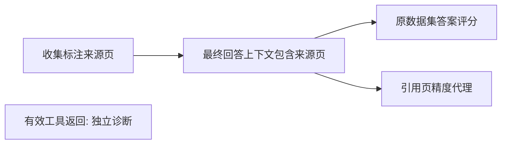
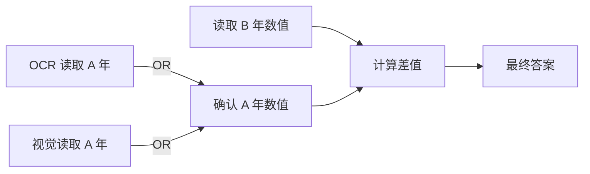

# DAG Agent 评测

项目提供独立的 DAG 评测层：有向无环图定义任务依赖，每个节点定义可执行的评分规则、通过阈值、权重和是否为必达目标。Agent 可以自行选择查询、OCR、读图和补检策略。此处的边是**评分所需的逻辑依赖**，不要求工具轨迹和图节点一一对应，也不检查调用时间先后。运行时 LangGraph 仍可循环补检。

## 两种图

`stage_proxy` 是从已有 ChartQA/PDFVQA 实验自动迁移的阶段图。现成标签只足以验证页级证据覆盖、答案分数和部分元素文本覆盖；不能自动生成可靠的中间计算标准答案。



默认权重分别为证据 0.2、上下文 0.2、答案 0.5、引用页 0.1。工具返回、元素文本覆盖的权重为 0，且不是必达节点。这样固定工作流不用模拟 Agent 工具调用，直接看图也不必执行 OCR。Oracle 原图阅读组不参与 DAG 分数，仍保留原始阅读成绩。这些权重是首版工程选择，尚未经过评测效度验证。

`task_rubric` 是逐题编写的子任务图，例如“提取 A 年数值”和“提取 B 年数值”可以并行，二者汇合到“计算差值”，再到最终答案。独立标注预期值、单位、容差和来源依据后，才适合称为题目级任务 DAG。标注状态可为 draft 或 reviewed；reviewed 必须填写 reviewer。自动迁移不会写入 reviewed。



OR 替代路径的节点通常设置 `required: false, weight: 0`，由一个 `dependency_mode: any` 的必达 gate 汇合；否则必达或带权的未采用分支仍会影响目标或加权分数。

## 节点定义

每题使用 `case_id` 和原始 case 的 SHA256 绑定标签、问题和范围。一个数值子任务节点示例：

```json
{
  "id": "difference",
  "description": "计算两年观测值的差，单位与原图一致",
  "depends_on": ["year_a", "year_b"],
  "dependency_mode": "all",
  "rule": {
    "kind": "value",
    "artifact": "difference",
    "metric": "numeric",
    "expected": 5.0,
    "absolute_tolerance": 0.01
  },
  "weight": 1.0,
  "threshold": 1.0,
  "required": true,
  "failure_tag": "task.calculation"
}
```

这里的 5.0 仅为格式示例，不是公开数据集的新标注。对应运行记录需要提供 `artifacts.difference.value`。新任务的 agent 适配器应约定可检查的中间产物；现有轨迹没有该字段时评分为未知。无需收集模型私有思维链，也不接受模型自报的 score。

| kind | 规则 | 观察来源 |
| --- | --- | --- |
| answer | 原始任务主指标，或指定适用指标 | 最终 answer / element_ids；沿用现有解析、弃答和失败口径 |
| set | 标注 ID 的 recall / precision | 固定白名单字段，例如 context_ranking |
| value | 规范化字符串匹配、数值容差、集合 EM/F1 | `artifacts.<artifact>.value` |
| tool | 指定工具成功返回，且命中要求的页 | trace.tool_calls；有成功状态但返回错误页不得分 |
| budget | 调用量、总 token 或延时不超过限额 | 已记录的调用与 provider usage；缺失 usage 不当作 0 |
| gate | AND/OR 依赖汇合 | 上游节点的最终状态 |

规则是固定类型的纯函数，不支持 `eval`、动态导入或在 JSON 中执行代码。suite 是评测侧私有材料；其中的标准答案、节点预期值不得拼入 Agent 提示词。答案、Wiki 或 Agent 自评不能充当评测标签来源。

## 分数与归因

每个节点先独立计算 `raw_score`，再检查依赖。依赖未满足时状态为 blocked，计分为 0，但原始得分和观察仍保留；因此“最终答案碰巧正确，但缺少要求的上游证据”可以被识别。

- `passed`：依赖满足且评分达到阈值。
- `failed`：依赖满足，已有观察但未达到阈值。
- `unknown`：依赖满足，缺少足够观察或中间产物。
- `blocked`：依赖未满足，`blocked_by` 指向阻塞前沿。原始 unknown 仍写入 raw_status。

逐题分数为节点加权分数除以固定总权重；未知与阻塞的节点占分母。`success` 要求所有 required 节点通过。`observation_coverage` 只统计带权节点的原始可观测比例。零权重诊断的未知状态仍保留在逐节点结果中。

汇总按实验组和原始任务类型分别报告，不混合 ChartQA、PDFVQA A/B 的官方指标。原始答案指标、成本和 badcase 标签同时保留。没有使用一张总图把所有题的中间步骤合成通用“推理链”。

`failure_frontier` 表示必达目标在这张已定义图上的最前端失败节点；它不是经反事实实验确立的因果根因。错误依赖、错误标注或漏观测都可能影响归因。页命中和页级引用精度也不能证明语义支持关系。不能把这些代理结果标成 OCR 正确率、真实事实核验通过率或新官方基准成绩。

## 运行

模块不读取模型密钥、不调用云端，也不修改原始 run/predictions。评分要求 manifest、索引、case 和实验计划一致；重复、越界预测和有环图都会拒绝。已有输出不会覆盖。

```powershell
.venv\Scripts\python.exe -m deepsearch_agent.benchmarks.dag init --prepared data/benchmarks/ablation-20261005 --run data/evaluations/ablation-20261005-formal --suite data/evaluations/my-dag-suite.json
.venv\Scripts\python.exe -m deepsearch_agent.benchmarks.dag validate --suite data/evaluations/my-dag-suite.json
.venv\Scripts\python.exe -m deepsearch_agent.benchmarks.dag score --prepared data/benchmarks/ablation-20261005 --run data/evaluations/ablation-20261005-formal --suite data/evaluations/my-dag-suite.json --output data/evaluations/my-dag-score
```

输出包含 `suite.json`、逐题逐节点 `node-results.jsonl`、含旧指标的 `summary.json` 和带 Mermaid 图的 `report.md`。报告记录 suite、原预测文件、run、评测代码和数据指纹，每项观察有字段路径及预测文件行号。

2026-10-07 已用旧模型 MiMo-V2.5 的 12 题、72 条完整消融轨迹进行一次离线迁移验收：60 条常规轨迹评分，12 条 oracle 保留在旧指标中；零云端调用。产物位于 `data/evaluations/dag-20261007-baseline/`。这不是 MiMo-V2.6-Pro 的新一轮实验。

## 参考与后续标注

[FDABench](https://github.com/fdabench/FDAbench) 提供面向异构数据 Agent 的 DAG 评测体系；[LangChain agentevals](https://github.com/langchain-ai/agentevals#graph-trajectory) 提供 LangGraph 图轨迹评估。这里采用现有本地轨迹和确定性规则，避免为了离线评分引入另一套 Agent 执行器或付费 judge。

要形成经验证的论文研究 Agent 基准，还需要独立审核一批多文献、多模态题目：标注子任务输入/输出、允许的替代路径、来源页/区域、数值与单位容差，再检验不同解法的公平性和标注一致性。应在新实验前冻结 DAG 和权重，按 held-out 文档划分测试集，并保留原始答案指标作为可比较基线。
