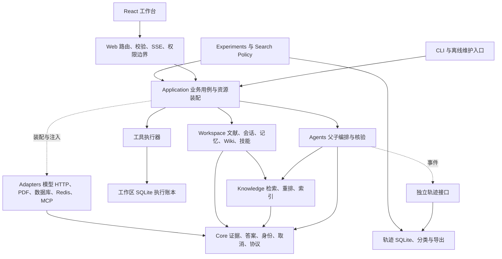
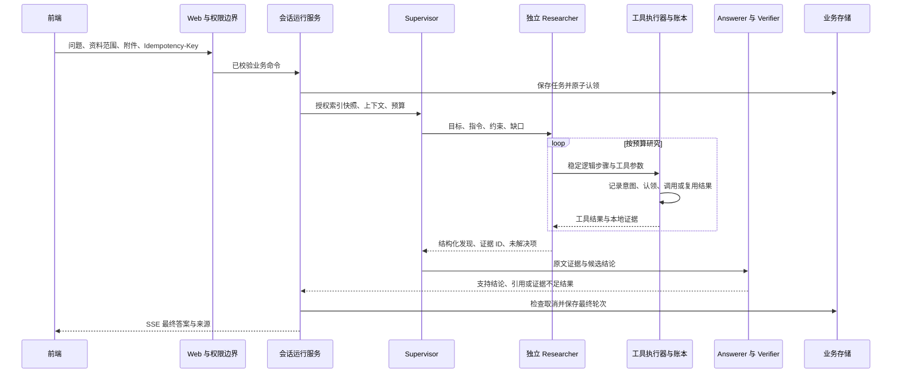
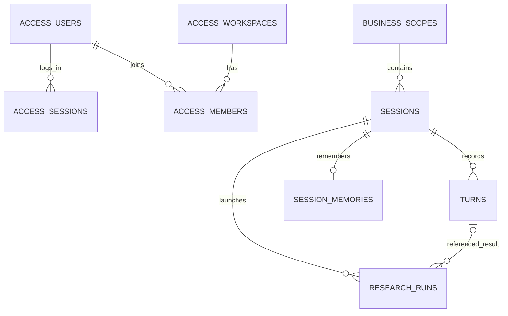
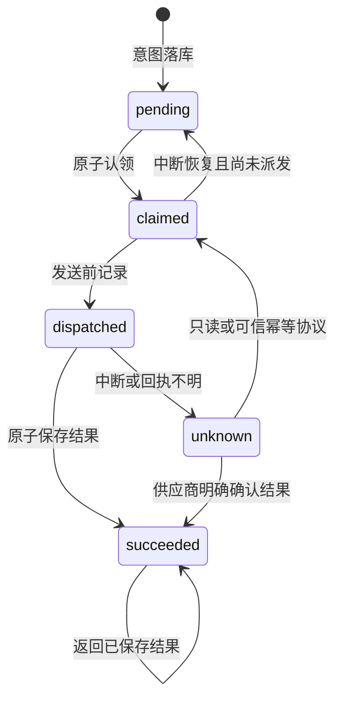

# DeepSearch Paper Agent 技术报告与面试讲解

> 版本依据：基线提交 `8c8199c` 及其后的工具执行账本增量，核对于 2026-10-19。本文用于讲清需求、架构、实现、关键取舍和验证结果。阅读顺序建议：先读第 1、2、4、13、18 节建立主线，再按面试岗位展开检索算法、Agent、数据库或可靠性设计。

## 目录

1. 项目定位与面试开场
2. 总体架构与模块边界
3. 资源装配与生命周期
4. 一次研究请求的完整执行过程
5. 共享契约与证据身份
6. 文献入库、PDF 与索引发布
7. 检索算法与多模态证据
8. 父子 Agent 编排与上下文隔离
9. 独立核验、多候选与路径剪枝
10. 模型网关与预算管理
11. 会话、记忆、Wiki 与技能
12. 数据库、账号与工作区隔离
13. 任务可靠性、取消与恢复
14. 工具执行账本与幂等恢复
15. Redis、可观测性与降级
16. 前端、HTTP 与 SSE
17. 独立轨迹、评测与离线训练
18. Badcase 驱动的迭代及真实结果
19. 测试、部署与数据恢复
20. 核心设计取舍与扩展路线
21. 面试追问与参考回答
22. 源码导读及讲解顺序

---

## 1. 项目定位与面试开场

### 1.1 要解决的业务问题

用户上传论文后，实际需要的不只是找到相似段落，还包括：围绕研究目标继续检索，处理跨页或跨文献关系，解释图表，保留原文依据，管理长期会话，并在任务中断后知道哪些操作已经完成。

项目围绕四类问题展开：

| 问题 | 对应设计 |
|---|---|
| 单轮检索覆盖不了多跳问题 | Researcher 使用工具循环按需补证 |
| 长工具日志挤占主 Agent 上下文 | 独立子上下文、结构化交接、按预算裁剪 |
| 答案看似合理但无法定位依据 | 稳定证据 ID、页码和原文引用、独立核验 |
| 重启、断连、重复提交导致状态或费用不明确 | 持久任务、提交幂等、检查点、工具账本 |

系统形态是**模块化单体、单 API 进程部署**。支持本地模式和可选小团队工作区；PostgreSQL 接管业务元数据，Redis 提供缓存及流量保护，原文、索引、检查点和轨迹保留各自的存储职责。

### 1.2 一分钟介绍

> 我做的是一个面向论文研究的多 Agent 检索平台。用户上传文献后，父 Agent 分派目标和约束，子 Agent 在独立上下文里调用检索、读页、OCR 等工具，再返回候选结论、证据 ID 和缺口，最后由独立核验角色检查原文。工程上，我把模型、检索、业务工作区、持久化和 Web 层拆开，加入 PostgreSQL 工作区隔离、Redis 缓存、任务恢复和工具执行账本。算法迭代通过固定 Badcase 做配对评测，分别分析正确率、核验决策和 Token 成本。这个项目的重点，是让研究过程可追溯、可恢复，并且能用实际评测决定哪些策略值得保留。

### 1.3 三分钟讲解顺序

1. 说明普通 RAG 在多跳检索、证据核验和长上下文上的问题。
2. 画出父 Agent、独立子循环、Answerer、Verifier 的执行关系。
3. 用一个问题解释片段 ID、授权检索、证据路径和最终引用。
4. 讲“工具成功但结果没落库就崩溃”的窗口，以及执行账本如何处理。
5. 用重复评测说明：局部少核验不一定整体省 Token，策略上线需要看端到端成本。

---

## 2. 总体架构与模块边界

### 2.1 架构图



图中的实线同时表达业务调用和组件协作，不等同于所有 Python 导入边。实际导入约束由 AST 依赖审计检查。

### 2.2 模块职责

| 包/目录 | 核心职责 | 代表入口 |
|---|---|---|
| `deepsearch_agent.core` | 共享数据、证据身份、错误、取消和跨边界协议 | `evidence.py`、`identity.py`、`tool_execution.py` |
| `application` | 组织问答、会话运行、恢复、维护和装配 | `answer_service.py`、`session_runs.py`、`bootstrap.py` |
| `agents` | 主图、子图、角色行为、任务契约、工具业务逻辑 | `runtime.py`、`agentic_research.py`、`tool_service.py` |
| `knowledge` | 分块、BM25、向量/图像检索、重排、索引服务 | `knowledge_base.py`、`index_service.py`、`ann.py` |
| `workspace` | 用户资料及研究状态的业务行为 | `documents.py`、`memory.py`、`llm_wiki.py` |
| `adapters` | 网络、模型、PDF、存储、Redis 和 MCP 的具体实现 | `llm_gateway.py`、`persistence/`、`tool_adapters.py` |
| `web` | HTTP DTO、响应转换、中间件和流事件编码 | `conversation_api.py`、`access.py`、`operations.py` |
| `deepsearch_tracing` | 标准库轨迹记录、分类、导出和审核 | `store.py`、`outcomes.py`、`quality.py` |
| `deepsearch_experiments` | 对照评测、消融、审计、历史基线 | `benchmarks/multihop/`、`architecture.py` |
| `search_policy` | 经审核的离线训练数据构建和训练器适配 | `dataset.py`、`training.py` |
| `frontend/src` | 会话、文献、证据预览、Wiki、账号与共享请求层 | `app/`、`features/`、`shared/` |

技术栈对应关系：Python 3.12+、FastAPI/Uvicorn 提供 API；LangGraph 编排状态图，Pydantic 校验模型与工具输出，HTTPX 接入模型；NumPy、jieba 支撑向量和词法检索；pypdf/pypdfium2 负责 PDF 提取与渲染；React 19、TypeScript、Vite 构建工作台；PostgreSQL/psycopg、SQLite、Redis 分别承载业务关系、本地执行状态和缓存；pytest、Vitest 用于行为回归。

### 2.3 为什么采用模块化单体

当前部署的主要复杂度来自长时间模型调用、索引快照、文件与数据库的一致性，而不是服务数量。保持单 API 进程，可以明确拥有索引锁、逐会话锁、工作线程和本地检查点。

模块边界先解决三件事：业务代码不依赖 HTTP 请求对象；工具业务逻辑不负责构造 LangGraph 工具；训练/评测不进入生产启动链路。这样以后替换模型网关或迁移向量索引时，可以沿实际接口修改，不必同时改动前端和业务流程。

### 2.4 可执行的依赖规则

- `core` 和独立轨迹包只依赖标准库及自身契约。
- 生产业务不导入训练器、评测运行器或轨迹数据库实现。
- 应用用例不导入 FastAPI/Starlette；装配入口承担框架和资源绑定。
- 工具服务通过适配器接入 LangGraph。
- 索引状态由 `IndexService` 持有，不在多个业务模块维护副本。

当前审计为 **206 个模块、500 条边、0 循环、0 违规**。这个检查能发现函数内部的延迟导入，不能靠把 import 移进函数绕开规则。

源码：[架构检查器](../src/deepsearch_experiments/architecture.py)、[架构说明](ARCHITECTURE.md)。

---

## 3. 资源装配与生命周期

`application.bootstrap.create_app` 是本地工作区的装配入口，负责读取配置、创建模型客户端、知识库、文献库、数据库仓储、检查点、工具账本以及可选 Redis/轨迹资源。

资源使用 `ExitStack` / `AsyncExitStack` 管理。初始化中途失败时，已经创建的资源也会释放；退出时按注册关系关闭任务工作线程、PDF 处理资源、检查点连接及网络客户端。线程任务先取消和等待，再关闭其仍可能使用的资源。

团队模式的 `bootstrap_team` 为每个授权工作区复用同一套应用装配。空间之间拥有独立索引、原件、Wiki、检查点、账本和轨迹；PostgreSQL 模式共用进程内连接池，通过事务空间上下文访问业务表。

资源路径从统一项目根和工作区根注入。模块移动不会依靠 `../..` 重新推算数据目录，避免重构后意外加载另一份索引或会话。

**面试讲法：**“我把构造资源与业务用例分离，资源谁创建、谁关闭都能定位到装配层。业务服务拿到的是已授权知识库、仓储或执行器，不负责自己连接数据库和启动线程。”

源码：[bootstrap](../src/deepsearch_agent/application/bootstrap.py)、[团队装配](../src/deepsearch_agent/application/bootstrap_team.py)、[路径契约](../src/deepsearch_agent/core/paths.py)。

---

## 4. 一次研究请求的完整执行过程

### 4.1 主执行链路



### 4.2 步骤与约束

1. **进入工作区。** 团队模式先鉴别账号和空间成员权限，再把请求分派到空间运行环境。
2. **校验命令。** 处理问题、文献范围、附件、技能参数；附件必须属于当前会话。
3. **提交去重。** 同一会话、同一幂等键对应同一次请求，改变问题或参数会冲突。
4. **准备身份。** 保存资料与片段 ID、模型/预算配置和上下文身份，供恢复比较。
5. **执行控制。** 每空间最多 4 个活动任务；同步请求与后台研究共享容量。逐会话锁保证轮次顺序。
6. **获取授权快照。** 先按资料范围限制候选语料，再交给 Agent；模型调用期间不长期持有索引锁。
7. **父子研究。** 子 Agent 独立执行，完整观察保留在子循环和轨迹中。
8. **生成与核验。** Answerer 提出结论，Verifier 检查授权原文；证据不足时可以返回明确的不完整结果。
9. **最终保存。** 检查取消信号，按 run_id 保存轮次，再更新任务完成状态。
10. **修复状态歧义。** 如果答案已落库而完成状态写入失败，通过已保存轮次修复，不重新调用模型。

`completed` 表示最终轮次已经保存，答案仍可能包含证据不足说明；它与模型核验结果、人工正确性是不同维度。

源码：[会话用例](../src/deepsearch_agent/application/session_runs.py)、[问答入口](../src/deepsearch_agent/application/answer_service.py)。

---

## 5. 共享契约与证据身份

### 5.1 TextChunk

`TextChunk` 同时表达内容与位置，包含正文、来源、页码、片段序号、章节路径、跨页映射、证据类型、视觉页码和稳定 ID。

这使检索结果可以从“字符串”提升为带出处的证据对象。重排和提示裁剪可以改变呈现长度，但最终引用仍能定位原始资料。

### 5.2 三类 ID 的用途

| 身份 | 组成 | 用途 |
|---|---|---|
| `content_id`，前缀 `cnt_` | 规范化内容指纹 | 判断内容是否相同 |
| `chunk_id`，前缀 `chk_` | 来源身份＋证据类型＋位置＋内容 | 去重片段、授权引用、验证索引 |
| `asset_ids`，前缀 `ast_` | 来源身份＋原页 | 关联正文、图像和 PDF 页 |

文本内容会统一换行并做 NFC 规范化后计算指纹；片段身份还保留来源和页码。因此两篇文献出现完全相同的段落，可以拥有相同内容身份，但仍有不同的片段身份。

**为什么不只使用向量行号？** 索引合并、删除、重建会改变行号；它适合检索器内部定位，不适合作为跨会话、引用和评测的长期身份。

### 5.3 其他共享契约

`Answer` 和引用类型表达最终业务结果；`LLMResponse` 统一模型文本、停止原因和可空 Token 用量；安全模型错误屏蔽供应商敏感详情；`CancellationToken` 贯穿同步线程和异步网络调用。

工具执行状态、操作结果封装和仓储协议也放在 `core`，而 SQLite 实现留在适配器。这样 Agent 可以依赖恢复语义，不依赖数据库表结构。

重构为旧检查点中的 `deepsearch_agent.chunking.TextChunk` 保留了最小类型别名，原文件可直接读取。数据反序列化兼容与执行恢复安全分别判断：能读旧检查点，不代表能补造缺失的工具执行历史。

源码：[证据类型](../src/deepsearch_agent/core/evidence.py)、[身份计算](../src/deepsearch_agent/core/identity.py)、[共享协议](../src/deepsearch_agent/core/ports.py)。

---

## 6. 文献入库、PDF 与索引发布

### 6.1 入库流程

文献模块负责接收资料、保存原件、更新处理状态、执行解析/视觉分析、构建片段和向量，然后发布索引快照。文字型 PDF、图片资料和会话附件入库复用相关处理能力。

关键链路为：

```text
上传与输入限制
  → 保存原件与资料记录
  → 受控 PDF 子进程解析
  → 可选逐页视觉分析及缓存
  → 分块与证据身份
  → 文本/原页图像向量化
  → 构造候选知识库
  → 持久化索引快照
  → 切换活动知识库
```

PDF 处理位于子进程，执行入口和输出格式受控，并有时间与文档大小限制。这为异常 PDF 的超时和解析失败提供了独立处理边界。文献处理线程属于单 API 进程，并非持久消息队列 Worker。

### 6.2 分块策略

- **固定分块**：按目标长度和重叠切片，适合早期兼容和简单正文。
- **章节规则分块**：识别标题、正文单元与页内位置，尽量沿语义边界组织片段；长单元再窗口切分，保留章节路径与页码映射。

章节路径能改善检索时的主题表达；跨页映射使最终引用能从片段回到原页，而不是把整段内容都粗略归到第一页。

### 6.3 索引原子发布

`IndexService` 持有知识库、锁、脏标记、持久化错误与写保护。

发布时先执行 `candidate.save(index_path)`，成功后才将活动 `kb` 指向新候选，并通知问答服务更新快照。保存失败则继续使用原知识库，避免出现“内存已经接受新资料，磁盘却没有”的状态。

恢复失败会进入写保护，要求明确修复快照，防止用空索引覆盖用户原数据。请求侧通过 `restrict_sources` 创建授权视图，不修改全局索引，也不重新向量化。

**面试追问：上传成功后 API 崩溃会怎样？** 原件、文献状态和索引发布不是跨全部存储的一个事务，需要根据处理状态和现有快照核对、重试。工具账本不覆盖整个文献入库流程，不能直接拿它证明上传链路只执行一次。

源码：[文献库](../src/deepsearch_agent/workspace/documents.py)、[PDF 适配器](../src/deepsearch_agent/adapters/pdf.py)、[章节分块](../src/deepsearch_agent/knowledge/section_chunking.py)、[索引服务](../src/deepsearch_agent/knowledge/index_service.py)。

---

## 7. 检索算法与多模态证据

### 7.1 BM25

BM25 处理精确术语、实体名、缩写和编号。代码维护文档频率与长度信息，中文文本使用分词处理。其核心打分思想为：

\[
\operatorname{BM25}(q,d)=\sum_{t\in q}\operatorname{IDF}(t)
\frac{f(t,d)(k_1+1)}{f(t,d)+k_1(1-b+b|d|/\operatorname{avgdl})}
\]

词频项有饱和效应，长度归一化避免长文档仅因词多占优。项目支持片段追加时增量维护词法索引；索引缩小或重置时重新构建。

### 7.2 语义检索与融合

文本 Embedding 表达同义、改写和跨措辞关联。向量归一化后，余弦相似度可用点积计算。

BM25 与语义分数的数值尺度不同，代码先分别做 Min-Max 归一化，再加权：

\[
\widehat{s}_r(d)=\frac{s_r(d)-\min s_r}{\max s_r-\min s_r},\qquad
S(d)=\alpha\widehat{s}_{semantic}(d)+(1-\alpha)\widehat{s}_{BM25}(d)
\]

某一路候选全部同分时，归一化为 1，使“被该路召回”仍有贡献；缺席该路的候选贡献为 0。默认语义权重为 0.5，最终取前 k 个片段。

这种融合容易解释和调参，但归一化依赖本次候选分布。权重应通过固定检索标注集选择，不能只观察几个回答判断效果。

### 7.3 自实现 IVF ANN

`AnnIndex` 使用 NumPy：

1. 少于默认阈值 1024 个向量时做精确扫描。
2. 达到阈值后执行 k-means 式聚类，建立倒排簇。
3. 查询先选相近簇，再在簇内计算向量分数。
4. 新向量加入已有索引时分配到现有中心，不每次重新聚类。
5. 候选簇为空时回退精确扫描。

精确相似度计算约为 `O(Nd)`；IVF 将计算拆成中心比较及候选簇内比较，实际收益取决于簇数量和探测范围。当前实现还使用排序选 top-k，不能把完整查询复杂度简化成只有点积成本。

它适合说明 ANN 原理并服务当前规模。长期增量会带来中心漂移，后续需要评估重建策略；扩至更大语料时，可替换为独立向量索引适配器，再以召回与延迟判断收益。

### 7.4 图像检索与 RRF

多模态检索有两条分支：一条检索正文/OCR/图表描述，一条直接对原页图像建立向量并编码文字问题。

两种向量空间不共享相似度尺度，采用排名融合：

\[
\operatorname{RRF}(d)=\sum_{r}\frac{1}{60+\operatorname{rank}_r(d)}
\]

每页当前只保留一个图像向量。命中后交付真实原页供视觉重排、回答和核验；系统没有实现 ColPali 式多向量 late interaction 或图表区域检索。

### 7.5 重排与上下文组装

纯文本重排器读取候选文本；多模态重排器按图片和 Token 预算分批读取原页。模型失败时保留原召回顺序。

随后按模型上下文窗口预留输出空间，装入可容纳的证据。检索 top-k 与模型最终看到的证据不是同一概念：部分片段可能在重排或预算裁剪中被移除，所以轨迹需要同时记录候选、最终证据和实际模型输入。

查询扩展能力在共享检索模块中保留，离线快速 QA 可在一次检索前自动扩展查询；生产子 Agent 主要通过多步选择检索词补充召回，不能把所有离线流水线环节都描述为每次生产请求必经。

源码：[知识库](../src/deepsearch_agent/knowledge/knowledge_base.py)、[BM25](../src/deepsearch_agent/knowledge/bm25.py)、[ANN](../src/deepsearch_agent/knowledge/ann.py)、[图像索引](../src/deepsearch_agent/knowledge/image_index.py)、[检索流水线](../src/deepsearch_agent/knowledge/retrieval_pipeline.py)。

---

## 8. 父子 Agent 编排与上下文隔离

### 8.1 四角色主图

| 角色 | 输入 | 输出与职责 |
|---|---|---|
| Supervisor | 问题、会话背景、已有结构化发现与状态 | 分派研究目标/约束，决定继续检索、生成或结束 |
| Researcher | 自包含子任务、可用工具、预算 | 独立工具循环，返回候选发现、证据 ID 和缺口 |
| Answerer | 问题及授权原文 | 组织结论、引用，实验策略下生成多个候选和路径 |
| Verifier | 候选结论与授权证据 | 检查支持关系、缺口、歧义，给出核验结果 |

主图循环为：`Supervisor → Researcher → Supervisor`；生成链路为 `Supervisor → Answerer → Verifier → Supervisor`。路由与停止守卫约束轮数和不合法终止，防止无界研究。

这些是使用明确输入/输出契约的角色调用，可以复用同一个模型服务；独立核验首先是调用上下文和职责独立，不代表天然拥有不同模型的独立错误分布。

### 8.2 子任务契约

`SubagentTask` 包含 `task_id`、`goal`、`instruction`、`constraints`、`gaps`、`top_k`。它不接受父 Agent 的完整 messages。

`SubagentResult` 包含状态、结构化 findings、证据 ID、未解决项、停止原因和工具调用数；核验标识始终是 `unverified`，等待后续独立核验。

例如父任务需要“比较两个方法的误差”，子任务应明确比较对象、评价条件和所缺证据，而不是只传“继续找一下”。这能减少独立子上下文丢失指代和限制条件。

### 8.3 工具循环与可信边界

子 Agent 每步输出结构化 `ToolAction`，选择一个工具及 schema-valid 参数。工具执行结果进入子图观察，经过预算裁剪后供下一步规划。

本地 `PaperToolSession` 维护授权来源、证据 registry 和工具预算。只有它能注册可引用片段。外部工具返回文本即使包含一个看起来正确的 chunk_id，也不能直接成为本地证据。

子图明确清除继承的父图检查点/运行配置，同时保留取消等请求 ContextVar。这样子消息不会混入父主图；新账本通过独立的逻辑操作身份补充子循环恢复。

### 8.4 控制通信体积

完整工具观察只进入子循环和轨迹。父调度器接收经过契约校验、证据 ID 过滤和 Token 预算裁剪的交接结果。Answerer 与 Verifier 仍可读取原文，避免把摘要压缩当成证据压缩。

需要衡量的通信指标包括约束保留率、证据 ID 保留率、交接裁剪比例和结论偏移；当前已记录相应观察点，尚不能仅凭结构化 JSON 就声称通信无失真。

源码：[任务契约](../src/deepsearch_agent/agents/subagent_contracts.py)、[子循环](../src/deepsearch_agent/agents/agentic_research.py)、[Researcher](../src/deepsearch_agent/agents/researcher.py)、[主图](../src/deepsearch_agent/agents/runtime.py)。

---

## 9. 独立核验、多候选与路径剪枝

### 9.1 默认生产能力与实验策略

默认真实问答采用父子 Agent 与独立核验。证据控制、多候选及增量复用由配置显式开启：

| 策略 | 主要变化 |
|---|---|
| 默认主线 | 独立研究、生成结论、核验引用和支持项 |
| 证据控制 v1/v2 | 必要关系覆盖、可执行核验动作、解释修订等增强 |
| v3 | 多候选、替代证据路径和可重放的路径完整性检查 |
| v4 | 稳定候选编号、补证、保守去重、重复生成/核验守卫 |
| v5 | 记录缺失要求，根据新引文增量核验、约束诊断长度 |

多候选策略保持实验状态，不把某一版实验效果写成默认线上行为。

### 9.2 候选—路径—步骤结构

一个候选代表完整答案和固定解释；每个候选最多三条替代路径，每条路径需要建立全部必要关系。结构是“路径之间 OR，路径内部要求 AND”。候选总容量为四个，不为填满数量而生成。

```text
候选：人物 A 的出生地是 X
  路径 1：作品 → 作者 A → A 的出生地 X
  路径 2：官方人物介绍直接确认 A 与作品、出生地
  每一步：requirement_index + claim + citation + exact quote
```

### 9.3 硬检查与语义核验分工

确定性检查器验证：引用编号是否属于本次证据快照，引文是否为精确子串，路径和证据是否与证书指纹一致。

引用越权或伪造引文可以剪掉该条提交路径；没有引文、路径为空则保留未知。某条路径无效不能直接证明候选命题为假，另一条路径仍可能成立。

语义核验器判断“引文是否支持主张”和“必要关系是否完整”。它是模型判断，不具备硬剪真值权限。候选可以是 unknown、supported 或 contested；多个相互竞争答案同时得到支持时，不应随意选一个。

### 9.4 候选复用和缺口复用

v4 固定候选答案/解释身份，补证时引用已有候选 ID，避免同一个命题换种说法占用新槽位。证据和任务输入未变化时跳过重复生成；空证明、相同未知输入可跳过无效核验。

v5 将核验器报告的缺失要求和证据见证集合保存下来，没有新见证时暂缓相关路径。这里的“缺口已确认”实际是“旧核验器报告过未知”，不等于缺口被形式证明。

当前见证指纹不含 claim 文本，因此“引文不变但推理主张已修正”仍可能被暂缓。已用出生地/旅行关系反例复现；下一版需要让主张和路径结构变化能重新打开核验机会。

源码：[路径完整性检查](../src/deepsearch_agent/core/evidence_paths.py)、[路径生成/核验](../src/deepsearch_agent/agents/path_answering.py)、[候选复用](../src/deepsearch_agent/core/candidate_reuse.py)、[缺口规则](../src/deepsearch_agent/core/verification_gaps.py)。

---

## 10. 模型网关与预算管理

### 10.1 模型能力分离

对话、文本 Embedding、视觉理解和图像 Embedding 分别配置。这样可为不同任务选择模型，并使缓存、索引与故障边界独立。

统一网关使用 HTTP 适配 OpenAI-compatible 协议，向上返回统一响应和安全错误。停止原因、截断、响应格式和 Token 用量不再由多个旧客户端重复解释。Token 用量缺失保持可空，不填 0。

例如供应商返回 HTTP 200 但 `finish_reason=length`，不代表完整结构化回答成功；评测会保留为输出截断失败，并保留已知费用。

### 10.2 多层预算

| 预算层 | 约束内容 |
|---|---|
| 模型上下文 | 输入证据、技能、历史和输出预留 |
| 工具会话 | 工具调用总数、OCR 次数、图像数、证据数、观察长度、截止时间 |
| 子循环 | 单轮最大规划步骤、重复调用守卫 |
| 主图 | 研究/核验轮数与路由守卫 |
| 可选研究控制 | 保留最终生成/核验资源、停止无增量检索 |
| 离线评测 | 明确统一的模型、搜索、Token、输出和时限预算 |

默认 `AgentSettings` 的工具调用上限是 18、单轮 8 步、OCR 2 次、证据 30 条、图像 8 张；这些是默认配置，不等于 MiMo 实验的 24 次模型调用、8 次搜索预算。

研究预算只能决定是否继续找证据，不能成为答案成立的依据。停止研究后应暴露缺口，而不是因为预算耗尽而放宽核验。

源码：[模型网关](../src/deepsearch_agent/adapters/llm_gateway.py)、[模型调用](../src/deepsearch_agent/agents/model_calls.py)、[Agent 配置](../src/deepsearch_agent/agents/agent_config.py)、[预算控制](../src/deepsearch_agent/agents/budget_control.py)。

---

## 11. 会话、记忆、Wiki 与技能

### 11.1 会话和结构化记忆

会话保存问题、答案、来源、附件与 run_id。结构化记忆保存研究目标、偏好、主题实体、开放问题及压缩进度。

`MemoryManager` 通过仓储公开方法读写，revision 乐观锁避免旧摘要覆盖新修改。近期对话直接提供，较早内容压缩后作为背景；历史助手结论不自动成为论文事实。

压缩前先认领对应批次，避免同一批失败在后续每轮被不断重新收费。记忆压缩是独立流程，不属于当前工具执行账本覆盖的全部模型请求。

### 11.2 Agent 工作记忆

`PLAN.md` 保存待做步骤，`HISTORY.md` 保存实际完成事项和明确用户偏好。它属于当前会话，使用内容哈希作为 revision。

写入必须先读，再提交读到的 `expected_revision`；既检查本轮读授权，也检查文件是否已被别人修改。写成功不视为再次读取。这样可以区分“知道一个 revision 字符串”和“本轮确实读过该版本”。

工作笔记标记为非证据，只给相关生成/调度上下文使用，不替代独立核验。

### 11.3 LLM Wiki

Wiki 将研究结果保存为可更新 Markdown/JSON 页面，携带原文引用、来源身份和关联信息。`WikiView` 按当前授权来源过滤页面；检索时可用它定位原始片段。

Wiki 是派生知识导航。模型必须回到原始证据回答，不能把之前生成的 Wiki 内容重复引用成新的独立事实来源。来源变更和缺失检查用于识别页面失效。

### 11.4 动态技能

`SkillRegistry` 发现本地 `SKILL.md` 的元信息，先展示简短目录，再按需加载正文，并受 Token 数和激活数量限制。读取时检查文件身份/修改信息，避免本轮发现后文件悄悄变化。

技能是研究方法提示，不是执行任意脚本的授权，也不是事实依据。它不能改变文献权限或取消核验。

源码：[结构化记忆](../src/deepsearch_agent/workspace/memory.py)、[工作记忆](../src/deepsearch_agent/workspace/working_memory.py)、[Wiki](../src/deepsearch_agent/workspace/llm_wiki.py)、[技能](../src/deepsearch_agent/workspace/skills.py)。

---

## 12. 数据库、账号与工作区隔离

### 12.1 数据分层归属

| 数据 | 存储方式与原因 |
|---|---|
| 用户、成员、登录会话、安全事件 | 默认身份 SQLite；可选 PostgreSQL，便于关系约束和事务 |
| 会话、答案、结构化记忆、研究运行 | 默认工作区 SQLite；可选 PG 表及 JSONB |
| 原文、附件、解析和视觉缓存 | 文件存储，便于原件预览及备份 |
| 文本/图像向量与片段 | 内存知识库＋JSON 快照，保留当前索引实现 |
| 主图检查点 | 独立 SQLite |
| 工具操作与事件 | 独立工作区 SQLite 执行账本 |
| 研究轨迹 | 可选独立 SQLite 哈希链 |
| 向量缓存与限流计数 | 可选 Redis，可丢弃或重建 |

引入 PostgreSQL 的目标是接管业务关系和并发状态，不把所有大文件、索引和审计流都塞到一个数据库表里。当前没有使用 pgvector，也没有业务数据双写。

### 12.2 业务关系图



身份空间与业务空间通过 workspace_id 关联到应用授权语义；图没有将它们画成不存在的数据库外键。数据库表名与字段细节以 schema 源码为准。

### 12.3 三层空间保护

1. Web 层检查账号、空间成员角色和读写权限。
2. 仓储查询显式携带 workspace_id，复合主键/外键防止跨空间引用。
3. PG 业务表强制 RLS，事务局部 `deepsearch.workspace_id` 决定可读写行。

连接池复用时采用事务局部 `set_config(..., true)`，不能把空间上下文留在连接会话中。应用角色禁止 superuser/BYPASSRLS；schema 初始化后启动只做版本及 checksum 核对。

### 12.4 账号安全与角色

密码使用 scrypt 加盐摘要；登录 Token 在服务端保存哈希。Cookie 使用 HttpOnly、SameSite=Strict，可配置 Secure。写请求结合精确 Origin 和自定义请求头进行保护。

空间角色为 owner、editor、viewer；系统管理员管理账号，不因管理员身份自动获得所有工作区资料权限。团队模式关闭 MCP 客户端与服务端，直到具备对应工作区授权路径。

### 12.5 事务和迁移

PG 轮次使用 `(workspace_id, run_id)` 唯一约束保障结果幂等；会话、记忆和恢复认领使用事务、revision 或条件更新控制并发。

迁移采用显式预检与 apply：源 SQLite 只读，目标非空拒绝覆盖，身份导入不迁移登录 Token，保留原 ID 和关联。schema 升级和数据导入分开执行；业务启动不自动迁移用户资料。

PG 故障时返回 503，不回落到旧 SQLite 写另一份业务数据，否则数据库恢复后会出现双数据源分叉。

源码：[PG 事务适配器](../src/deepsearch_agent/adapters/persistence/postgres.py)、[表结构和 RLS](../src/deepsearch_agent/adapters/persistence/postgres_schema.py)、[业务仓储选择](../src/deepsearch_agent/adapters/persistence/business.py)、[授权边界](../src/deepsearch_agent/web/access.py)。

---

## 13. 任务可靠性、取消与恢复

### 13.1 持久任务与执行线程

任务记录与实际线程分离。`research_runs` 保存请求、状态、阶段及结果关联；`RunWorkers` 负责进程内执行容量、取消和关闭等待。

状态主要包括 queued、running、cancel_requested、cancelled、interrupted、completed。启动时将遗留 queued/running 标为 interrupted，不把它们自动当成新任务重新执行。

当前的持久化是任务元数据和检查点持久化，执行载体仍是进程内线程，没有持久队列的自动调度和跨机器接管。

### 13.2 请求幂等

`Idempotency-Key` 以会话为作用域计算提交身份。已完成请求直接返回原轮次；运行中的重复提交返回冲突；同键但请求内容不同拒绝。

没有键时，每次提交都是新任务。系统无法仅凭两个问题字符串相同就判断用户是不是有意重问。

### 13.3 检查点恢复

恢复时依次检查：

1. 当前账号/会话是否有权访问该 run。
2. 是否已保存答案；有则修复关联，直接返回。
3. 是否为 interrupted。
4. 文献范围、片段、模型/预算、会话上下文、技能及 Wiki 身份是否一致。
5. 是否有主图检查点及匹配的工具账本。
6. 原子认领恢复权，再进入图恢复。

主图通过相同 thread_id/run_id 继续，并采用同步持久化选项。但检查点只覆盖图状态，不能让远端工具与本地存储自动进入一个事务，因此还需要下一节的工具账本。

### 13.4 取消与 SSE 断连

前端 SSE 断开不自动取消后台任务。明确取消会设置取消信号，网络模型任务也可接收取消；迟到的进度不能覆盖 cancel_requested 或终态。

保存答案前再次检查取消；结束服务时取消并等待已接纳工作完成。取消可以停止本地继续执行，不能撤销已经发生的远端效果或收费。

源码：[任务服务](../src/deepsearch_agent/application/session_runs.py)、[请求身份](../src/deepsearch_agent/application/run_reliability.py)、[取消信号](../src/deepsearch_agent/core/cancellation.py)。

---

## 14. 工具执行账本与幂等恢复

### 14.1 核心问题

最危险的窗口是：工具已经成功，进程在结果写入检查点前退出。只从图检查点恢复会重放节点，并可能再次调用工具。

执行账本把恢复粒度推进到逻辑操作：用 run_id＋研究轮次＋规划/工具步骤生成稳定 operation_id，另存工具、参数和恢复策略摘要。相同参数的两个有意操作仍有不同步骤身份；同一个步骤换参数会冲突。

### 14.2 状态机



数据库中 claimed/dispatched 是 running 的 phase，而不是两个独立 status。认领 owner 用于条件更新；旧 owner 不能覆盖恢复后的记录。成功状态和结果 JSON 在同一 SQLite 事务提交。

### 14.3 分类恢复

| 类别 | 示例 | 未确认时策略 |
|---|---|---|
| 只读 | 读页、取证据、纯本地 BM25、读工作笔记 | 可以重试，请求可能重复 |
| 付费 | OCR、包含嵌入/重排的搜索、子规划 | unknown，默认阻断 |
| 有副作用 | 工作笔记 replace、外部 MCP 工具 | unknown，默认阻断 |

供应商支持幂等时，可信适配器从首次调用起声明版本化协议，并实际传递同一操作键。供应商明确结果查询返回确认封装后，才能消解 unknown；普通 not_found 和超时不证明原请求未执行。

### 14.4 与 Agent 恢复的联动

仅固定 tool_call_id 仍不够：恢复后重新规划可能选择不同工具。因此子规划动作也落库，研究节点重放时先恢复原动作，再复用已提交工具结果。证据片段、工作笔记和工具预算随主图状态保存。

新接口提供每个运行的操作状态、种类和尝试次数，不向客户端返回参数及结果内容。没有账本的旧检查点不能自动补造操作历史。

### 14.5 保证的含义

“网络请求只发送一次”和“业务效果只发生一次”是两件事。只读重试可以增加请求数；具有供应商幂等保障的写请求也可能发送多次，但效果一次。没有供应商支持且效果不明时，项目通过阻断换取安全，需要后续核对才能继续。

本次覆盖持久会话的子规划与工具；一次性无运行身份入口、独立 MCP 服务请求和父角色模型调用未全部纳入。它也不把文件工作记忆写入与 SQLite 账本变成分布式事务。

源码：[核心契约](../src/deepsearch_agent/core/tool_execution.py)、[执行器](../src/deepsearch_agent/application/tool_execution.py)、[SQLite 账本](../src/deepsearch_agent/adapters/persistence/tool_ledger.py)、[工具适配器](../src/deepsearch_agent/adapters/tool_adapters.py)。

---

## 15. Redis、可观测性与降级

### 15.1 Embedding 缓存

缓存键结合版本、模型、地址、维度、凭据作用域和输入文本哈希；值为校验后的向量。同批重复文本只计算一次，返回时保持原输入顺序。

模型更换必须隔离缓存，否则相同维度也可能来自不同向量空间。损坏向量或维度错误视为未命中；模型请求失败不写缓存。

Redis 使用连接池、短超时、失败冷却和总等待上限。故障时绕过缓存走原 Embedding 服务；它不能代替工具账本，因为缓存可过期或丢失，也不记录请求效果未知状态。

### 15.2 限流

修改类 API 请求按连接来源限流。Redis Lua 将计数和过期原子完成，避免 INCR 成功而 EXPIRE 失败留下永久键。

Redis 故障时回退有容量上限的进程内计数，超限返回 429 和 Retry-After。故障切换可能重置计数，因此它属于流量保护，不是费用结算配额。

### 15.3 故障语义

| 组件 | 失败后的行为 |
|---|---|
| Redis 缓存/计数 | 降级，本地限流或绕过缓存 |
| PostgreSQL 业务库 | 业务与 ready 返回 503，不写影子库 |
| 工具账本 | 阻止工具执行或恢复 |
| 可选轨迹记录 | 尽力记录，失败不阻断问答 |
| 索引快照恢复 | 写保护，避免覆盖用户数据 |

不同组件是否允许降级，取决于它是否决定业务事实和重复执行安全，而不是统一套“失败就回退”。

### 15.4 可观测性

HTTP 携带请求 ID，访问日志记录路由模板、状态和耗时，不记录问题正文。live 判断进程是否可响应；ready 检查索引写保护、数据库和基础设施状态，不调用付费模型。

请求 ID、业务 run_id、轨迹运行 ID、子任务 ID、模型调用 ID、工具 operation_id 分别定位不同层次。面试时可以用“请求失败在哪一层”解释为什么不能只保留一个 UUID。

源码：[Redis 适配](../src/deepsearch_agent/adapters/infrastructure.py)、[运行中间件](../src/deepsearch_agent/web/operations.py)。

---

## 16. 前端、HTTP 与 SSE

### 16.1 前端模块

`app/App.tsx` 协调页面与共享状态；`features/library` 管理上传、处理轮询和资料范围；`features/chat` 管理会话、附件、记忆和研究交互；`features/evidence` 负责原文/图片预览；`features/wiki` 管理派生知识页；`features/access` 管理登录和空间选择。

`shared/api.ts` 统一请求、类型与错误处理。按业务功能组织后，证据预览和会话逻辑不用继续堆在一个 App 文件中。

### 16.2 Web 层职责

Web 层校验请求、转换 DTO 和响应、编码 SSE，并调用应用用例。文献处理、任务恢复和数据库行为不写在路由函数里。

典型接口包括资料上传/处理、会话轮次、运行列表、取消/恢复、工具操作查看，以及 Wiki、记忆和技能操作。团队模式在相同业务接口前添加空间边界，不复制第二套业务实现。

### 16.3 SSE 语义

SSE 先推送 queued/planning/retrieving/drafting/verifying 等阶段；核验完成后再分段发送最终答案及来源。它不是把未经核验的模型原始 token 直接发布给用户。

工作线程通过队列交付事件，HTTP 层处理编码和心跳。断连后用户应查询原运行，而不是自动新建问题。前端幂等键、任务列表和后台执行状态需要配合使用。

**为什么选 SSE？** 研究进度和答案主要是服务端单向推送，SSE 对当前交互足够；双向频繁控制或实时协作需求再考虑 WebSocket。

源码：[前端功能目录](../frontend/src/features/)、[共享 API](../frontend/src/shared/api.ts)、[会话路由](../src/deepsearch_agent/web/conversation_api.py)。

---

## 17. 独立轨迹、评测与离线训练

### 17.1 轨迹与账本职责不同

轨迹解释“Agent 看到了什么、做了什么判断”；账本决定“一个操作是否能重新执行”。因此轨迹可以关闭、写入可以尽力而为，账本缺失则必须阻断相关执行。

`deepsearch_tracing` 仅依赖标准库，通过事件作用域关联父子任务与调用。记录包括实际任务、工具观察、结构化交接、裁剪后父输入、角色请求/响应、最终答案及安全诊断。

SQLite 事件按序号和前一事件哈希构成哈希链，用来检测意外修改或缺失。它不包含签名密钥，不能宣称能抵御任意重算全部哈希的攻击者。

### 17.2 三种“成功”分别统计

| 维度 | 含义 | 例子 |
|---|---|---|
| 执行状态 | 函数/任务是否正常完成或保存 | completed、interrupted、cancelled |
| 内部研究分类 | 是否有完整记录、最终答案和内部核验 | success/failure/unknown |
| 人工/基准正确性 | 答案是否符合独立标准 | correct/incorrect/unknown 或 EM/F1 |

运行轨迹中，内部核验通过并观察到最终答案可分 success；明确异常或已知不完整结果可分 failure；未结束、记录失败、缺结论等保持 unknown。候选证据不足时的 unknown，不能直接等同于整次运行的 unknown。

离线 benchmark 的分组还使用金标与弃答规则，必须注明分类来源；不能把它与运行时内部核验分组混成一个准确率。

### 17.3 质量闭环

轨迹冻结后用运行身份和事件哈希绑定人工标签，记录期望行为、证据、根因和修复引用。修复后以匹配的问题、语料、模型和预算重新运行，再比较新旧审核。

旧错例只有在新运行被复核正确、条件匹配且存在修复引用时才关闭；缺候选、缺审核、条件改变或只有旧运行改标，不能算修复。

### 17.4 离线训练扩展

`search_policy` 读取公共轨迹，执行候选提取、人工审核、去重、分组切分和 SFT 导出。它提供训练器适配，不在 Web 请求中执行训练，也不把 Verifier 的通过标志直接当作训练 reward。

这让“在线研究应用”和“离线数据生产”共用证据接口，同时保持生命周期、依赖和正确性标准分离。

源码：[轨迹分类](../src/deepsearch_tracing/outcomes.py)、[通信导出](../src/deepsearch_tracing/communication.py)、[质量审核](../src/deepsearch_tracing/quality.py)、[训练数据](../src/search_policy/dataset.py)。

---

## 18. Badcase 驱动的迭代及真实结果

### 18.1 迭代过程

最初的失败包括多跳必要关系未覆盖、实体或角色解释混淆、重复补证和核验、候选只因缺证据被过早排除。改进依次增加必要关系覆盖、可执行核验反馈、多候选路径、稳定候选补证及缺口增量复用。

每个机制都需要同时看正面效果与新成本。例如候选去重可能减少重复命题，却因更多上下文或修复调用增加总 Token；跳过一条核验路径，也不等于省下一整次模型调用。

### 18.2 最近一次重复对照

从已有 MuSiQue、2Wiki 题池固定选 20 题，保留原 4 题、增加 16 题；每题 v4/v5 各重复三次，共 120 次真实预测、60 个配对观测。

实验固定 MiMo v2.6 Pro、原 sampled_pool 语料、BM25、top-k=5，每题模型调用 24、搜索 8、Token 预算 256000、输出 8192、上下文 131072、时限 600 秒。失败不自动重试，费用保留；KABG 错误金标只从正确率统计隔离。

| 轮次 | v4 Token | v5 Token | v5 成本变化 |
|---|---:|---:|---:|
| 1 | 538,795 | 660,748 | +22.63% |
| 2 | 601,025 | 582,234 | −3.13% |
| 3 | 543,478 | 525,530 | −3.30% |
| 合计 | 1,683,298 | 1,768,512 | **+5.06%** |

按题把三次重复整体重采样，成本下降比例的 95% 区间为 `[-18.78%, +8.29%]`，跨零。正确率为 `22/57 → 25/57`，变化区间也跨零。

自然缺口复用触发 9 条路径，涉及 7 次运行、6 道题；只有 3 次跳过整次核验。Verifier 总调用反而从 64 增至 76，Answerer 也增加成本，所以局部跳过未形成整体稳定节省。

### 18.3 误暂缓如何评估

对自然暂缓路径做不展示金标/旧结论的额外模型判断，并清空缺口状态重放实际核验器。审计费用单独记账，不混入主对照节省。

9 份盲审有 7 份有效、2 份引文无效；核验重放有 1 条路径改判 supported，但没有选中该候选，且存在解释分歧。没有人工标签，真实误暂缓率为 null。

另外，通过构造“同引文、已修正关系主张”的确定性反例，证实当前规则可能误暂缓正确推理更新。这个发现推动下一版修复指纹和失效规则，而不是继续扩大同一有缺陷规则的调用规模。

### 18.4 面试中的价值表达

> 我没有只用一次小样本结果判断优化成功，而是固定语料、模型和预算做重复配对，把 Token 费用和核验行为关联起来。扩容后发现原本的小样本节省没有稳定复现，还构造出了误暂缓反例。因此我保留实验策略，把改进方向收敛到缓存失效和重复生成循环，而不是把一次节省直接作为上线收益。

报告：[重复对照](REPEATED_GAP_EVALUATION_20261019.md)；数据：[公开结果包](../eval/results/gap-repeats-20261019/README.md)。

---

## 19. 测试、部署与数据恢复

### 19.1 验证层次

| 证据 | 最近记录 | 能说明什么 |
|---|---|---|
| 工具账本后端完整回归 | 997 passed、14 skipped | 当前本地后端回归；跳过项不计通过 |
| 最近一次前端验证 | 62 tests、11 files 通过，构建通过 | 2026-10-19 发布前验证；账本增量未改前端 |
| 工具进程退出实验 | 14/14 断言通过 | 实际退出/重启＋模拟供应商请求、效果、计费 |
| 依赖审计 | 206 模块、500 边、0 循环/违规 | 当前源码边界 |
| 数据库联合验收 | 2026-10-18 真实 PG、Redis、API 容器报告通过 | 当时版本的服务、RLS、重启与故障恢复 |
| 真实模型对照 | 20 题×3 次×2 版 | 固定开发题上的成本和质量观察 |

不能把单元测试数、合成故障测试和真实模型准确率混作一种验收指标。

### 19.2 14 组退出实验中的关键场景

| 场景 | 请求数 | 效果/模拟计费 | 恢复 |
|---|---:|---:|---|
| 已认领、未派发 | 1 | 对应操作最多 1 | 执行完成 |
| 只读完成、结果丢失 | 2 | 0 | 安全重试 |
| 付费完成、结果丢失 | 1 | 计费 1 | unknown，阻断 |
| 写入完成、结果丢失 | 1 | 效果 1 | unknown，阻断 |
| 结果已提交、图检查点未提交 | 1 | 最多 1 | 复用 |
| 供应商幂等，效果后结果丢失 | 2 | 效果/计费 1 | 同键重试 |

子进程通过 `os._exit(73)` 实际退出。供应商是独立 SQLite 模拟服务，没有真实收费；实验分别统计请求数和效果数，避免把它们都称为“调用一次”。

### 19.3 部署

Docker Compose 支持 API、Redis，以及显式启用的 PostgreSQL 覆盖配置。持久文件卷仍保存原件、索引、Wiki、工作记忆、检查点、账本和轨迹；仅备份 PG 不足以恢复整个研究工作区。

当前使用单 API 进程。PG 的引入没有自动消除内存索引所有权、本地检查点和文件锁的单进程约束。

### 19.4 备份与恢复

部署锁限制 API 与维护工具同时写入。离线备份保存业务数据库及文件集，检查链接、路径范围、文件变化、SQLite sidecar 等，完成后生成清单与哈希。

还原演练在新目录和隔离数据库/容器中执行，核对表计数、内容指纹与应用读取；不会直接覆盖原部署。登录会话可撤销，账号摘要和业务记录保留。

已有实际 PG/Redis 容器及还原验收记录；本次报告整理没有重新启动这些服务。没有连续 WAL/PITR、自动多地备份或生产 SLA 承诺，后续建设应围绕 RPO/RTO 目标展开。

证据：[账本验证](TOOL_EXECUTION_LEDGER_VALIDATION_20261019.md)、[数据库验收](DATABASE_VALIDATION_20261018.md)、[运行与恢复验收](RELIABILITY_VALIDATION_20261018.md)、[容器与 Redis](CONTAINER_REDIS_E2E_20261018.md)。

---

## 20. 核心设计取舍与扩展路线

### 20.1 已采用的取舍

| 选择 | 解决的问题 | 代价 |
|---|---|---|
| 模块化单体＋单 API | 明确状态和资源所有权 | 不能直接水平扩容 |
| 父子独立上下文 | 控制主上下文体积与日志干扰 | 交接可能丢失条件，需要契约和轨迹 |
| 原文授权与独立核验 | 提高证据可定位性 | 模型核验仍可能误判，增加成本 |
| 硬剪路径而保留未知候选 | 避免缺证据直接否定命题 | 未知候选占预算，需容量及终止规则 |
| PG 只接管业务关系 | 获得事务和 RLS，兼容文件索引 | 备份与恢复必须覆盖多种存储 |
| Redis 故障降级 | 缓存不成为问答可用性的硬依赖 | 无严格费用配额或跨进程击穿控制 |
| 未确认写入保留 unknown | 避免盲重试造成重复副作用 | 需要供应商查询或人工核对推进 |
| 训练与轨迹实现独立 | 生产依赖更清晰，可迁往离线环境 | 要维护身份、审核和导出契约 |

### 20.2 后续建设顺序

1. **优先修复证据缺口复用失效规则。** 主张、关系方向和路径结构变化应重新核验，之后再以同题同预算重复评测。
2. **补齐恢复链路的状态细节。** 工具结果回放不仅要恢复观察，还要核对工具内部授权/版本状态；工作记忆读授权就是需要专门验证的状态。
3. **接入可信供应商幂等/查询。** 让真实付费工具能确认未知状态，再扩展到更多模型调用角色。
4. **以指标驱动检索优化。** 固定问题—文献/页码标注，比较召回、核验后的证据覆盖与端到端正确率。
5. **有扩容需求再引入独立 Worker。** 需要一起设计租约和 fencing、任务队列、对象存储、索引版本发布和分布式认领，不能只把 `workers` 改成多个。
6. **完善运营能力。** 用户用量、费用统计、供应商故障告警、定期备份和恢复演练，应分别设定可验证指标。

这些是后续路线，未实施部分不计入当前成果。

---

## 21. 面试追问与参考回答

### Q1：和普通 RAG 最大的区别是什么？

普通 RAG 常见链路是一次检索后生成答案。这里增加了按目标补证的研究循环、独立子上下文、结构化交接和核验，并将任务恢复、资料权限和质量评估纳入业务流程。核心区别是有状态研究过程及其工程保障。

### Q2：为什么不用一个大 Prompt 完成所有工作？

大 Prompt 会混合目标、工具日志、候选结论和核验职责，后续很难定位丢失了哪项约束。角色分离后可以控制各自输入，并记录“任务下发—子结果—父决策—核验”的中间边界；代价是额外调用和交接损失，因此还要做成本评测。

### Q3：为什么主 Agent 不看全部工具日志？

主 Agent 需要判断下一步研究方向，不需要每次 HTTP 结果和失败重试文本。完整日志保留在子循环和轨迹；父 Agent 看结论、证据 ID、缺口和停止原因，核验角色再看原文。这样控制上下文体积，同时保留复核入口。

### Q4：摘要会不会丢信息？

会，所以子任务必须自包含，交接经过 schema 和引用授权检查，轨迹同时保存原观察与裁剪后父输入。后续可统计约束和证据保留率；结构化格式保证可解析，不保证信息绝不丢失。

### Q5：有引用就说明答案正确吗？

引用检查只能确认“这段文字来自授权资料”。例如“某人是维也纳作曲家”不必然证明“出生于维也纳”。是否蕴含主张、实体是否一致、关系是否完整，仍需语义核验和独立评测。

### Q6：为什么同时做 BM25 和向量检索？

论文包含大量缩写、方法名和编号，BM25 对精确词有效；向量对改写与语义关联更有帮助。项目通过归一化加权融合两路文本分数，图像分支再用 RRF 融合排名。权重需要用固定标注集验证。

### Q7：自实现 ANN 的价值是什么？

它把精确扫描、聚类、探测和增量分配这些机制做成可运行实现，适配当前规模，也便于解释召回与延迟取舍。它不是大规模向量数据库的替代品；扩容时应比较专用方案和重建成本。

### Q8：为什么用了 PostgreSQL 还保留 SQLite？

PG 负责业务关系、并发更新和 RLS；本地图检查点、工具账本和轨迹各有写入及生命周期语义。把它们都迁到 PG 需要额外适配收益分析。当前保留多个存储后，备份必须把数据库与文件卷一起处理。

### Q9：如何防止连接池串工作区？

每次事务设置 transaction-local workspace_id，结束后不留下会话级租户状态；查询有空间条件，业务表强制 RLS，复合外键防跨空间引用，应用角色不能绕过 RLS。权限还要在 Web 层检查，数据库隔离不是成员管理的替代品。

### Q10：Redis 挂了为什么能继续，PG 挂了为什么不回退？

Redis 保存可重建缓存和限流计数，故障可降级。PG 保存最新业务事实，回退旧 SQLite 会产生两份不同数据。相同的“提高可用性”不能套用到不同一致性职责上。

### Q11：为什么有检查点仍需要工具账本？

检查点粒度是图状态。工具成功到节点提交之间仍有窗口，恢复可能重跑节点。账本以逻辑步骤记录意图、发送阶段和结果，成功结果直接复用，未确认写入保留未知。

### Q12：能保证 exactly-once 吗？

本地已确认结果可以不再调用；外部操作的效果一次需要供应商幂等或确定查询。请求可能发两次但效果一次；没有供应商支持时通过阻断未知调用避免盲重试，不能把这说成所有请求只发一次。

### Q13：幂等键为什么不用参数哈希？

同样参数可能是两个有意独立操作。操作身份应由运行和逻辑步骤决定，参数哈希用来验证这个步骤有没有换请求。提交级键、操作键和模型消息 ID 分别承担不同职责。

### Q14：工具异常为什么不都交给 Agent 自己重试？

只读失败可以安全观察和调整，但付费或写入超时可能已经产生效果。让模型换个说法再试会绕过去重。因此未知执行结果要在运行层阻断，模型不能自行声明重试安全。

### Q15：SSE 中断后怎么办？

断开流连接不代表后台取消。前端通过运行 ID 查状态，已保存答案直接取回；真正中断则显式恢复。重新提交应使用原幂等键，不能用新请求假装恢复旧任务。

### Q16：多候选的创新点在哪里？

多候选本身是已有思路。这个项目探索的是候选、替代路径、确定性见证检查、未知保留和增量核验的组合，并通过误剪、误暂缓和成本数据评估。是否形成研究贡献还要看更广泛对照与稳定收益。

### Q17：v5 是不是更省 Token？

四题一次对照曾下降 9.37%，扩大到 20 题三次重复后合计增加 5.06%，区间跨零。当前只能确认机制触发，不能确认稳定降本。核验调用次数和回答生成增长抵消了局部跳过。

### Q18：如何衡量误剪或误暂缓？

先记录每条决策所用路径和证据，再用独立标签判断该路径是否本来充分。基线正确、候选版本错误只能作为风险信号；同模型审计也不是真值。本轮无人工路径标签，真实误暂缓率保持 null，同时用确定性反例检验规则安全性。

### Q19：为什么要按题聚类 Bootstrap？

同一道题的三次重复相关，不能把 60 个配对当成 60 道独立问题。每次抽样把该题三个重复整体抽入，得到条件于这组开发题的成本比例区间。

### Q20：success 轨迹能直接做训练正样本吗？

不能。success 可能只表示内部核验通过，模型和核验器可能同时错。训练数据还需要独立审核、证据、去重和分组切分，避免将系统自己的错误循环强化。

### Q21：能否直接多开几个 API Worker 扩容？

不能。当前索引所有权、线程任务、文件锁和本地检查点仍与单进程协作绑定。需要先拆分任务执行、明确队列与认领协议，处理索引版本和文件共享，再谈多副本。

### Q22：你最值得展开的一次技术判断是什么？

可以讲扩大评测后否定“稳定降本”的判断，或讲检查点之外的未知工具状态。前者体现实验设计与成本归因，后者体现对分布式执行窗口和幂等边界的理解。两者都有可运行代码和记录可展示。

---

## 22. 源码导读及讲解顺序

### 22.1 十分钟源码演示

| 顺序 | 打开文件 | 要解释的要点 |
|---|---|---|
| 1 | `application/bootstrap.py` | 装配、资源关闭、工作区根与数据库选择 |
| 2 | `application/session_runs.py` | 提交幂等、执行认领、结果修复、恢复前提 |
| 3 | `agents/runtime.py` | 四角色图与检查点 |
| 4 | `agents/researcher.py`、`subagent_contracts.py` | 自包含任务、独立子结果、稳定任务身份 |
| 5 | `agents/agentic_research.py` | 工具规划、观察、预算、动作持久化 |
| 6 | `agents/tool_service.py` | 授权来源、证据 registry、工具分类 |
| 7 | `application/tool_execution.py`、`persistence/tool_ledger.py` | claimed/dispatched、结果复用与 unknown |
| 8 | `knowledge/knowledge_base.py` | 范围快照、混合召回和图像 RRF |
| 9 | `core/evidence_paths.py` | 引文完整性检查与路径级剪枝 |
| 10 | `eval/results/` 与验证报告 | 用数据解释收益、失败和下一步 |

### 22.2 可核对的关键材料

- [总体架构与依赖规则](ARCHITECTURE.md)
- [模块迁移与清理清单](ARCHITECTURE_MIGRATION.md)
- [子 Agent 上下文边界](SUBAGENT_CONTEXT.md)
- [父子通信轨迹](COMMUNICATION_TRACES.md)
- [账号与工作区](TEAM_ACCESS.md)
- [PostgreSQL 数据库](DATABASE.md)
- [任务、备份与质量闭环](RELIABILITY_RECOVERY_QUALITY.md)
- [工具账本设计](TOOL_EXECUTION_LEDGER.md)
- [工具账本验证](TOOL_EXECUTION_LEDGER_VALIDATION_20261019.md)
- [重复评测报告](REPEATED_GAP_EVALUATION_20261019.md)
- [脱敏结果明细](../eval/results/gap-repeats-20261019/README.md)
- [进程退出实验](../eval/results/tool-ledger-faults-20261019.json)

### 22.3 面试准备检查表

能够现场画出主图和子循环；解释 content_id 与 chunk_id；走通一次上传到引用；指出权限检查发生在检索之前；说明 PG/RLS、Redis 与本地文件的不同职责；用崩溃窗口解释 unknown；说清评测的题目数、重复次数、预算和实际成本结果。

针对后端岗位优先展开第 3、6、12–16、19 节；针对 Agent/RAG 岗位优先展开第 5、7–10、17–18 节；面向系统设计追问，则从第 20 节讲当前取舍和下一阶段需要共同改造的边界。
